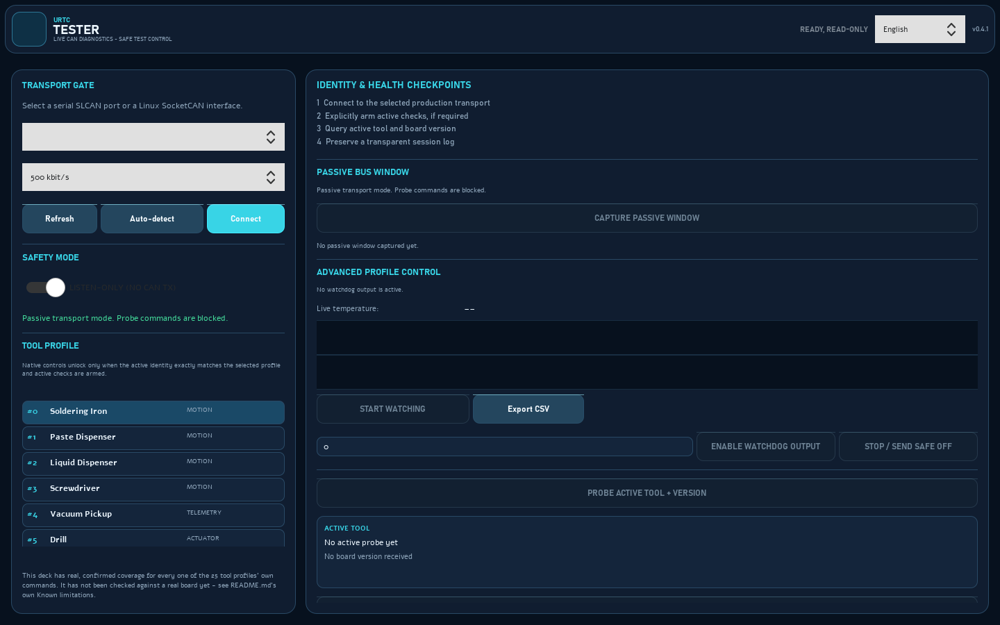

<p align="center">
  
</p>

# URTC Tester (Windows / Linux)

<p align="center">
  🇺🇸 <b>English</b> |
  <a href="README_spa.md">🇪🇸 Español</a> |
  <a href="README_fra.md">🇫🇷 Français</a> |
  <a href="README_ita.md">🇮🇹 Italiano</a> |
  <a href="README_deu.md">🇩🇪 Deutsch</a> |
  <a href="README_zho.md">🇨🇳 简体中文</a> |
  <a href="README_jpn.md">🇯🇵 日本語</a> |
  <a href="README_por.md">🇵🇹 Português</a>
</p>


<p align="center">
  
  
  
  
</p>


**Version:** 0.4.2 · **Author:** JuanenRac (Electro Hobby 3D) &lt;electrohobby3d@gmail.com&gt;

License: **GPL-3.0-or-later** for the source code, **CC BY-SA 4.0** for this
documentation - see `LICENSE` in this repository, or the "License and
Copyright Notices" section at the end of this document.

A live CAN bus exerciser for the URTC board. It connects over the same
USB-CAN adapter the flasher uses, asks the board which of its 25 tool
profiles it's currently jumpered for, and shows only that tool's own
controls and telemetry - not one window trying to represent all 25 at
once. Everything it does is a runtime command or a telemetry read against
the currently-running application; it never touches flash, so there's
nothing here that can leave the board any less working than it started.

**Honesty check - what actually runs today:** the CAN payload encoders for the migrated Qt Quick control families (`advanced_protocol.py`) are real and covered by the tests in `tests/` (`python -m pytest -q`). This repo's own CI (`.github/workflows/ci.yml`) runs them too, together with `ruff check`, `python -m mypy`, `tools/ci_validate.py`, a syntax compile of every `.py` file and the four `verify_qt_*.py` scripts, so a regression there fails the build. The four `verify_qt_*.py` scripts at the repo root (`verify_qt_custom_frame.py`, `verify_qt_telemetry_watch.py`, `verify_qt_utility_panels.py`, `verify_qt_selftest.py`) are real, deliberately-outside-`tests/` end-to-end checks against a fake transport with real cross-thread Signal delivery - all four pass with `QT_QPA_PLATFORM=offscreen python verify_qt_*.py`, which CI runs too. That's the honest ceiling of what's automatically verified: the transport layer, CAN ID/byte-layout handling, and the Qt Quick bridge logic are real and exercised against mocked frames, not real hardware - as "Known limitations" below already says, this was built with no USB access, so nothing here has been checked against a real board yet. `qt_tester.py` and `assets/qml/TesterDeck.qml` are the real, substantial implementation (thousands of lines combined), exercised by the tests with fake boards and by the verify scripts, never by a real board.

> **Safety and security status:** this ecosystem is not a certified safety system, and no populated URTC board exists yet. The bootloaders check firmware images with CRC32 and a shared-key HMAC-SHA256, not with an asymmetric signature (planned); the published application images are signed with the public development key (`signing_key_kind: dev`), so anyone can produce an image the bootloader accepts; nothing has been transmitted to a real board. Read the [security baseline](https://github.com/JuanenRac/URTC-DOCS/blob/main/docs/SECURITY_BASELINE.md) and the [threat model](https://github.com/JuanenRac/URTC-DOCS/blob/main/docs/THREAT_MODEL.md) before relying on any statement here for the safety of a person.

## 📋 At a glance

| | |
|---|---|
| Version | `0.4.2` |
| Maturity | Functional |
| Stack | Python / PySide6 / Qt Quick / live CAN bus diagnostics |
| Target | The PC of the person using it |
| On real hardware | Simulated only: tested against emulators, fakes or simulators; no run on real hardware is recorded for this version |

## 1. 🆚 Relationship to the flasher

This tool and [URTC Flasher](https://github.com/JuanenRac/URTC-FLASHER) share the same transport layer (SLCAN and
SocketCAN classes are identical) since both ultimately just need to get
CAN frames on and off the same kind of adapter, but they do fundamentally
different jobs:

| | Flasher | Tester |
|---|---|---|
| Touches flash | Yes (that's the whole point) | Never |
| Talks to | The bootloader, mostly | The running application |
| Purpose | Update firmware | Exercise/verify a tool head's actual hardware |

If you're not sure which one you need: if the board is already running
firmware and you want to check a tool actually works (heater heats,
motor turns, LED lights up), you want this one.

## 2. 📦 Install and run

Same pattern as the flasher:

```
pip install -r requirements.txt
python urtc_tester.py          # Windows
python3 urtc_tester.py         # Linux
```

Or build a standalone binary: `build_exe.bat` on Windows, `./build_exe.sh`
on Linux. Both clean `build/`/`dist/` first and bundle `assets/` (the
banner and icon) into the executable - see
[docs/BUILD_AND_RUN.md](docs/BUILD_AND_RUN.md) for the non-versioning
`build-test.bat`/`build-test.sh` validation path these packaging scripts
build on, and the flasher's own README for the fuller reasoning behind
the packaging scripts themselves, since it applies identically here.

**Versioning:** `TESTER_VERSION` (in `tester_config.py`, shown in the
title bar, About dialog, session logs, and debug bundles) follows
`MAJOR.MINOR.PATCH`. It is raised only by the explicit `python bump.py` step
(through `bump_version.py`), base-10 "odometer" style: PATCH
+1, carrying into MINOR once PATCH passes 9 (e.g. `0.1.9` → `0.2.0`).
Running from source (`python urtc_tester.py`) and building
(`build_exe.bat`/`build_exe.sh`) never touch it. MAJOR is never bumped
automatically, only by hand. See `CHANGELOG.md` for the version history.

### Visual command deck

The **Qt Quick** command deck is now the real default:
~~~
python urtc_tester.py
~~~
It uses the SLCAN/SocketCAN transports and starts in listen-only
mode, so it cannot transmit until you deliberately arm active checks. Every
one of the 25 tool profiles' own commands has real, confirmed coverage here
(motion, drill, AOI, electromagnet, spot/ultrasonic weld pulse, paste
jetting, flying probe, thermal inspection, the 5 watchdog-keepalive
actuators, vacuum/scan-probe telemetry), each gated the same way: an
identity match, an explicitly armed active mode, and a user confirmation in
QML before anything transmits. Nothing here has been checked against a real board yet - see "Known limitations" below.

The deck also shows the **live readouts** of the detected tool (temperature with a rolling graph and CSV export, RPM, endstops; they only listen, so they work in listen-only mode and next to a running output), runs the **self-test**, warns in the header when the **bus health check** (a query of the active tool every 3 seconds while nothing else uses the bus) sees a problem, and has an **About URTC Tester** dialog with the Readme, the License and the GitHub page, next to **Save Logs...**.

The header of the Qt Quick window has a language selector; the choice is saved and applies on the next start. It also queries and resets the position of the soldering iron's wire feeder (open-loop estimate; the reset asks for confirmation). The identity probe also shows the firmware patch number when the board sends it (URTC firmware 0.3.5 and newer); older firmware shows major.minor only.

The existing live-CAN diagnostic workflow now uses a dark navy/cyan command-deck surface: product header, high-contrast connection card, clear tool tabs, dark session log and visible progress channel. This visual and accessibility change does not alter passive monitoring or command routing, and none of it has been tried on a real board.

### Header and tools

- **Header** - the connection state, the bus-health warning, the language selector (the choice is saved and applies on the next start) and the version.
- **Save Logs...** and **EXPORT SESSION (LOG WITH HASH)** - the on-screen log as plain text, or a zip with the log, a manifest that names it by its SHA-256 and system diagnostics (see "Logs and debug bundles" below).
- **About URTC Tester** - version and author, with buttons for the **Readme** (in the language of the interface when a translation exists), the **License** and the project's **URTC GitHub** page.

### File structure

This tool is organized into modules by responsibility, purely for
readability - there's no functional difference between having them as
separate files versus one large one. See the
"📂 Repository Structure" section near the end of this document for
the full file-by-file breakdown.

**Language**: English by default. Chosen with the selector in the header of the window - switches the interface (labels, buttons, dialogs, and log messages) to any of the 8 available languages, saved
immediately to `config.json` next to this tool, applied on the next
launch. Translations live in plain text files under `language/`
(`english.lng`, `spanish.lng`, `italian.lng`, `french.lng`,
`german.lng`, `chinese.lng`, `japanese.lng`, `portuguese.lng`) as simple `KEY=Value`
pairs, one per line - lines starting
with `#` and blank lines are ignored, and a literal `\n` inside a value
becomes a real line break (used by the handful of multi-line dialog
messages). Generated from the catalog of URTC-COMMON (a translation is corrected there and the files are written again, never edited by hand), or a starting point for another language (add `language/<name>.lng`, add
`("<name>", "Native Name")` to `AVAILABLE_LANGUAGES` near the top of
`tester_config.py`, and set `"language": "<name>"` in `config.json`). A
key missing from a language file falls back to showing that key's own
name rather than crashing, and a missing or unreadable language file
(bad edit, wrong filename) falls back to English for the whole
interface - either way the tool stays usable while the mismatch gets
sorted out.

**Linux SLCAN/SocketCAN setup** (adapter reflash, serial permissions,
`ip link` bring-up) is exactly the same as the flasher's section 1 - see
[URTC Flasher's own README](https://github.com/JuanenRac/URTC-FLASHER)
sections 1 and 2 rather than duplicating it here.

## 3. ⚙️ How it works

The window is laid out in three columns: left and center hold the
always-visible sections below (1-4, then 6), right holds section 5's
per-tool panel, which is the one part of the window that actually
changes based on what's detected. Splitting the always-visible sections
across two columns instead of stacking them all in one keeps the window
from growing tall enough to not fit on an ordinary screen as more of
these sections were added over time. The 3D printer's own tool panel
(the tallest of the 25) goes a step further and splits its own controls
into 2 sub-columns internally, for the same reason. See
[docs/ARCHITECTURE.md](docs/ARCHITECTURE.md) for the module-level
architecture this section walks through.

**Connect** (section 1, identical to the flasher): pick Serial/SLCAN or
SocketCAN, the port/interface, optionally auto-detect the bitrate, then
Connect.

**Detection happens automatically on connect** (or click **Detect** to
redo it): the tool sends `0x110` (query active tool) and `0x7F8` (query
version), and uses the response to:
- Show which of the 25 tool profiles is active, and the board's overall
  state (any declared error, CAN bus fault, still-in-boot-splash).
- Show the reporting HardwareID and firmware version, flagging a mismatch
  if it doesn't match this project's own `THIS_HARDWARE_ID`.
- Build the **Tool Controls** panel on the right for that specific tool -
  and only that tool. Switching which tool is jumpered and detecting
  again tears down the old panel and builds the new one from scratch.

**Global Controls** (section 2, always visible regardless of which tool
is active): the status LED color override, the ring LED color and
on/off, and OLED display mode (`0x100`) - these apply to every tool, so
they don't move to the dynamic panel. In AOI Inspection mode specifically,
the ring's on/off here is ignored in favor of that tool's own strobe
control (per [docs/CANBUS.md](docs/CANBUS.md)) - color still applies either way.

**Expansion Board** (section 3, always visible): `CONN_EXPANSION`'s own
generic SPI bus and DIAG0 line - the raw passthrough every driver-
carrying expansion board variant shares. The ADS1115 and MLX9064x
sensors, and the crimping actuator's own driver, aren't controlled from
here - they live inside their own tool's own panel instead (Flying
Probe, Thermal Inspection, Crimping Actuator - see section 4
below), since which of those actually applies depends on which tool
profile is jumpered.

**Persistence F-RAM** (section 4, also always visible, but deliberately
separate from Expansion Board above): the FM24CL64B shares the OLED's
own hardware I2C2 bus - a core board component, not something wired to
`CONN_EXPANSION` at all. Grouping the two together would imply a connection between them
that isn't real - the expansion connector itself has no F-RAM, no EEPROM,
nothing non-volatile on it.
- **SPI passthrough**: type space-separated hex bytes (1-7 of them, e.g.
  `01 02 03`), hit Send, and see exactly what came back on MISO during
  that same transfer (`0x180`/`0x181`) - a raw byte transport, not
  TMC5160-register-aware, matching the firmware's own approach. Useful
  for exercising the bus itself before a specific expansion board's
  register protocol is worth building a dedicated panel for.
- **DIAG0 level**: **Query DIAG0** reads the current state of a TMC5160's
  stall/fault diagnostic line (`0x182`/`0x183`) - HIGH (inactive) or LOW
  (asserted). A simple polled read, not a live/pushed value - hit the
  button again to refresh it.
- **Persistence F-RAM**: **Query State** reads back whatever the board
  last saved before a power loss (`0x190`/`0x191`) - which tool it was,
  the setpoint, whether a critical error was active at the time.
  **Erase F-RAM...** wipes it (`0x192`, with a confirmation dialog first
  - this can't be undone).
- **Expansion board type**: **Query** shows which of the 7 possible
  `CONN_EXPANSION` configurations is currently set (`0x1A1` - see
  `EXPANSION.TXT`). Read-only here - set it from `URTC Flasher`'s own CAN
  OTA section instead, since it's a one-time hardware-configuration step,
  not something to change casually from a live diagnostic tool.
- **MLX9064x sensor variant**: **Query** shows which of the 3 MLX9064x
  family members (or none at all) is currently configured (`0x1A7` -
  see `CANBUS.md`) - only meaningful when the expansion board type
  above is an Advanced variant or Basic+MLX9064x. Read-only here, same
  reasoning as expansion board type above.
- **Free tool configuration**: **Query** shows the raw ID-jumper reading
  (0-31) alongside what the F-RAM's `free_tool_selection` register
  currently says (`0x1A3` - see `EEPROM.TXT` section 5) - only actually
  consulted by a board whose jumpers read 0x1F/11111b. Read-only here,
  same reasoning as expansion board type above - `URTC Flasher` is the
  only tool that writes it.
- **Peripheral type & serial number**: **Query** shows the fixed
  peripheral type (always URTC/0x03) alongside the currently-set device
  serial number (`0x1A5` - see `EEPROM.TXT` section 6), a host-assigned
  label for telling multiple otherwise-identical boards apart on the
  same CAN bus. Read-only here too - `URTC Flasher` writes the serial
  number, this tool only ever reads it back.

**Custom CAN Frame** (section 6, also always visible): a raw ID + hex
bytes entry with one-shot and periodic send - for a command that doesn't
have its own control here yet, or for testing something not (or not yet)
documented in `docs/CANBUS.md`. No validation beyond ID range and DLC≤8;
whatever this sends is exactly what goes on the bus. Same section also
opens the **Raw Bus Monitor** (see below).

**Run Self-Test** (next to Detect): runs a small set of safe, at-rest
communication checks for whichever tool is currently detected - confirms
the active-tool query and version query both respond, then (for tools
with telemetry) sends a safe setpoint/speed/power of 0 and checks the
expected telemetry arrives. Deliberately never sends anything that would
actually heat, fire, or spin at meaningful power - this verifies the
communication round-trip works, not that an actuator physically responds,
since confirming that needs a human watching anyway. Asks for
confirmation before sending anything. Tools with no telemetry (plain
motion) or that are purely event-driven (scan probe) get an info-only
note instead of a real pass/fail. **Coverage is partial**: only 7 of
the 25 tools have a defined self-test step (soldering iron, drill,
laser, 3D printer, AOI, vacuum, scan probe) - the other 18 tools don't
run any check when this button is pressed.

**Live temperature graphs**: the soldering iron and 3D-printer nozzle
panels both show a small rolling line graph alongside their live
temperature reading - a plain Qt Quick Canvas, not a new
dependency (matplotlib/pyqtgraph would break this tool's zero-dependency
policy beyond pyserial). Fixed Y-axis scale (0 to that tool's own
setpoint ceiling) rather than auto-scaling, so the trend is easy to read
at a glance rather than the scale shifting under it.

**Raw Bus Monitor** (opened from the Custom CAN Frame section): a
separate window showing every frame seen, any ID, independent of the
active tool panel - a live-scrolling table (Time/ID/DLC/Data/Δt),
Pause/Clear, and an approximate bus-load/frame-rate readout (updated
once a second; the load figure doesn't model bit-stuffing overhead, so
treat it as a rough diagnostic figure, not a certified measurement).
**Export .trc...**/**Export .asc...** save the currently-shown table as a
simplified PEAK PCAN-View / Vector CANalyzer-style trace file
respectively - close enough to be readable by most tools that expect
those formats, not guaranteed byte-identical to what the real
applications produce. If `urtc_custom_ids.json` exists next to this
script (optional, not included by default - `{"0x199": "My Sensor"}`),
the ID column shows that friendly name alongside the raw hex ID -
useful for anyone testing a custom expansion board's own traffic without
needing to modify this tool's source.

## 4. 🧰 Tool coverage

Every one of the 25 profiles has its own panel, built directly from
`docs/CANBUS.md`:

| Tool | Controls | Live telemetry |
|---|---|---|
| Soldering Iron | Setpoint temperature, on/off; wire feeder direction + step count (one-shot); feeder position query + reset to 0 | Actual temperature; feeder position (open-loop estimate) |
| Paste/Liquid Dispenser, Screwdriver, both Grippers, SMT Pick & Place, Vacuum Gripper (LG) | Direction + step count (one-shot move) | none (shared 0x120, no telemetry for any of these 7) |
| Vacuum Pickup | none | Analog reading, part-detected |
| Drill | Speed + direction | Actual RPM, endstop |
| AOI Inspection | Ring mode (off/strobe/continuous) + strobe period | Endstop |
| Laser Engraver | Power + laser-lock arm/safe (a firmware output, not a hardware interlock) | Endstop |
| 3D Printer | Nozzle setpoint, extruder direction/steps, layer fan power, hotend fan power | Hotend temperature, layer fan RPM, hotend fan RPM |
| Scan Probe | none | Impact event count + timestamp (max-priority `0x095`) |
| Electromagnet | Energize/release checkbox | none |
| Spot Welder | Pulse duration + Fire | none (fires only if the contact sensor reads HIGH first - see `docs/CANBUS.md`'s own `0x1C0`) |
| Conformal Coating, Press-Fit Inserter | none - informational panel only | none - both tool IDs have no CAN handler at all, their own actuator and sensor live on the robot's own mainboard, see `docs/TOOLS.TXT` |
| Flying Probe | Basic reading is automatic; advanced reading needs a raw ADS1115 config word (hex) + Trigger Conversion + Read Result | Basic onboard-ADC reading (automatic, `0x243`) |
| UV Curing | Power slider (0-255) + Send/Off | none |
| Hot Air Rework | Setpoint temperature, blower power, on/off | Live temperature (shares the soldering iron's own `0x135` telemetry and live graph - same physical thermal loop) |
| Crimping Actuator | Direction + step count (one-shot move, same shape as the shared motion tools above, but reaches an expansion board's own driver via `0x1F0` instead of the onboard `0x120`) | none |
| Thermal Inspection | Trigger Capture, Check Status, Read Thermal Image | 32x24 pixel heat-map canvas (blue-to-red gradient), pulled chunk-by-chunk over CAN on request - not a live video feed, see section 6 below |
| Solder Paste Jetting | PWM channel + frequency (Configure), then duty + duration (Fire Pulse) | none |
| Ultrasonic Welder | Pulse duration + Fire | none (same shape as Spot Welder, but no contact-sensor gate) |

**Communication watchdogs are handled for you.** The soldering iron,
Hot Air Rework (shares the same thermal loop and watchdog as the
soldering iron), laser, and 3D-printer nozzle each have a 250ms
watchdog in firmware; the layer fan has a 1000ms one. Checking the
relevant "Active" box doesn't just send the command once - it resends
automatically (150ms for the 250ms-watchdog tools, 400ms for the layer
fan) for as long as the box stays checked, the same way a real master
controller has to. Unchecking it sends a single zero/off frame and
stops. The hotend fan has no watchdog (a stall detector instead - see
`docs/CANBUS.md`), so it's a plain one-shot send.

**Convenience notes (software conveniences, not safety functions).**

- **STOP ALL OUTPUTS** (in both windows, available while connected with active checks armed) sends every known off command - the heaters, the laser, the drill, the UV lamp, the layer fan, the electromagnet release, the plain steppers and the crimper - whatever tool is fitted, and stops every refresh. The hotend fan is left running on purpose, because the nozzle may still be hot. This is a software command sent over the CAN bus, not an emergency stop: it cannot act if the bus, the adapter, the PC or the board fails.
- The one-shot weld pulses, the paste pulse and the crimp ask for a confirmation in the classic window too, as the Qt Quick deck always does.
- The drill and the UV lamp are refreshed like the laser and the heaters. While the 3D-printer heater is held, its 150 ms refresh carries 0 extruder steps, which the firmware reads as a stop order: an extruder move started in that state is cancelled within 150 ms, so move the extruder with the heater off until the firmware offers a mode that leaves the extruder alone.
- The port and the bit rate are remembered for the next session (`config.json`) and the Qt Quick deck has its own bit rate selector. **Auto-detect** first only listens at each rate (nothing is transmitted on a live bus) and asks at each rate only when the bus is completely silent.
- The Raw Bus Monitor can be limited to some CAN IDs (**ID filter**) and to frames whose data changed (**Only changes**).

### 🔥 Thermal runaway bench test (URTC firmware 0.3.2+ / 0.3.3+)

Detect now shows *why* a board latched an error: `0x111` byte 4 (thermal
runaway guard: MAXTEMP, HEATING_NO_RISE or DROPPED_AT_TARGET) is shown in the
board state, and a reset caused by the hardware watchdog (`0x111` byte 5) is
logged. **Thermal counters** (F-RAM panel in both UIs) reads `0x1AA`/`0x1AB`:
lifetime thermal faults, total heater-on hours and the last fault. Answers
from older firmware (4-byte `0x111`, no `0x1AB`) are reported as "not
reported", never as zero. The step-by-step procedure to confirm the guard on
a real board is [`docs/THERMAL_RUNAWAY_BENCH_TEST.md`](docs/THERMAL_RUNAWAY_BENCH_TEST.md).

## 5. 📋 Logs and debug bundles

Same as the flasher: a timestamped session log is written automatically
to `logs/` (safe to delete), and **Export Debug Bundle**
saves a `.zip` with the current on-screen log plus basic system
diagnostics (OS, Python version, current transport/port/bitrate, detected
tool) for handing to whoever's debugging a tool head issue.

### 🤖 Without a window: test plans

`python urtc_tester.py --headless COMMAND` runs the tester without a window, for a production line, a bench script or a CI job: `info` (who answers: tool, firmware, quick state), `selftest`, `run-plan FILE` and `validate-plan FILE`. A plan is a short JSON file of steps kept in `plans/` (expect a tool, no faults, a minimum firmware version, the self-test, a frame whose value lies in a range, a wait, a question for the person at the bench). The command writes a log of every frame and a result record that names the log by its SHA-256, the same record as the deck. A plan sends only queries unless it says `"actuation": true` and the operator adds `--allow-actuation`; the boot-loader, update, configuration and erase frames are never sent, a command that the firmware drops unless it is refreshed (a heater, a drill, a laser) can be repeated while the plan waits (`keepalive_ms`), and every output is switched off again after a plan that commanded something. `--transport simulate` plays a simulated tool head and `--transport replay --port FILE` a recorded `.trc` or `.asc` trace, so a plan can be tried without a board. Exit status: 0 passed, 1 a check failed, 2 the plan or the arguments are wrong, 3 the test could not be carried out. The text it prints is English, like the command line of the flasher. Details in [`docs/HEADLESS.md`](docs/HEADLESS.md). Nothing here has run against a real board.

**Plans in the window (new, checked with tests and the simulated head only):** the section TEST PLANS at the bottom of the right column of the deck lists the plans of `plans/`, runs the one you choose against the connected board with the same engine (not in listen-only mode, and only while nothing else reads the bus), shows each step as soon as it ends, asks the questions of a confirm step in a dialog and saves the log and the result record. A plan that commands outputs asks for a confirmation first and every output is switched off at the end; Cancel stops it after the step that is running.

**Check for updates.** The button "Check for updates" asks GitHub once for the latest release and, only if it carries a package for this system that is newer than the installed version, offers to download it. The package is accepted only if its SHA-256 and its Ed25519 signature (the key of the releases, pinned in the program) are valid; it is installed only after you confirm it, never while an output is on, and the previous version is kept so you can go back (and is restored by itself if the new one does not start). Nothing is ever checked or installed on its own: the check when the program opens is an option, off by default, and the confirmation can only be turned off in the same window after a warning.

**Replay a recorded trace.** "Open Trace" loads a `.trc` or `.asc` trace (the ones the bus monitor exports, or PCAN-View and CANalyzer ones) and plays its received frames into a list of their own, marked REPLAY, at 0.25x to 10x, with pause, stop and repeat; a silence longer than two seconds is shortened. A replay never transmits, never answers a request, never mixes with the monitor of the bus or with its export, and it will not play while a board is connected (it pauses itself if one connects). A file larger than 50 MB or with no received frame is refused and says so.

**Black box viewer.** The record read from the board, and any record saved earlier (`.json` or `.csv` written by this program, opened with "Open a saved record", no board needed), is drawn as the measured temperature and the set-point over time with a mark where the error flag was first set, and listed sample by sample with the flags in words. Every field must be a whole number in range and a record holds at most 67 samples; a file that is not a record is refused with the reason and the previous drawing stays.

**Without hardware:** a virtual board stands in for the adapter and the board. Start `python -m urtc_can.virtual_board`, then give its serial URL to the port (`--transport serial --port socket://127.0.0.1:7777`); the board answers the version query and the quick state like an application, so `info` and plans of queries run end to end with nothing connected. It is a model written from the protocol description, not a tool head: the self-test of a tool reports what it cannot read.

## 6. ⚠️ Known limitations

This tool's evidence contract - what counts as pass/fail/unknown, why
absent evidence is always unknown rather than pass, and why it grants no
firmware-flash authority of its own - is documented in
[docs/INTEGRATION_CONTRACT.md](docs/INTEGRATION_CONTRACT.md).

- **Not tested against real hardware.** Every piece here - the transport
  layer, the CAN ID/byte-layout handling, the watchdog keepalive timing -
  was checked in isolation (mocked frames, a real subprocess for timing
  where relevant) but the environment that built this has no USB access.
  Treat a first real session with the same caution the flasher's own
  README asks for.
- **One tool panel at a time, by design**, not a current limitation to be
  removed later - see the intro above for why.
- **Global LED colors are a straight override**, not a live readback -
  there's no telemetry for what the status/ring LEDs are actually
  currently showing, only what was last commanded.
- **Thermal Inspection's own thermal image is pull-based, not a
  live feed.** Reading a full frame means requesting all 48 chunks
  sequentially over CAN (worst case, MLX90640/MLX90642's own
  resolution) - this can take a few seconds, and there's no streaming
  push mode in this tool's own CAN protocol to make it faster. A capture has to be triggered first; Read Thermal Image then waits up to two seconds for the sensor to report ready and, if it does not, reads nothing, because the firmware does not answer chunk requests before that. The sensor fitted is asked first (48 chunks for the MLX90640/MLX90642, 12 for the MLX90641), and a chunk that is lost leaves its pixels blank instead of shifting the rest of the image.
- **Run Self-Test only covers 7 of the 25 tools** (soldering iron,
  drill, laser, 3D printer, AOI, vacuum, scan probe) - see "How it
  works" above for the full explanation. The other 18 tools get no
  automated check from that button; verifying them still means
  watching the actual hardware respond to their own panel's controls.

## 📂 Repository Structure

```
/
├── urtc_tester.py             Entry point - starts the Qt Quick deck
├── qt_tester.py                Qt Quick front end - real default, read-only-by-default command deck
├── tester_config.py            Config/language/protocol constants (CAN IDs, tool
│                                names, MOTION_TOOL_IDS, AVAILABLE_LANGUAGES,
│                                EXPANSION_BOARD_TYPES)
├── tester_transports.py        SLCAN and SocketCAN transport classes
├── tester_bus_monitor.py       Background CAN read thread (CANBusMonitor)
├── tester_autodetect.py        Bit-rate search for an SLCAN adapter
├── tester_selftest.py          Self-test steps and runner (no window code)
├── tester_plan.py              Test plans: validation, runner and the "all off" after them
├── tester_cli.py               The tester without a window (--headless): info, selftest, run-plan
├── tester_simulator.py         Simulated tool head and recorded-trace player
├── plans/                      Example test plans (JSON)
├── tester_telemetry.py         Live readouts of each tool and the recorded series
├── tester_trace_export.py      Writers of the .trc / .asc frame exports
├── tester_replay.py            Replay of a recorded .trc / .asc trace (a player with no timer of its own)
├── tester_blackbox_view.py     The black box record as the deck draws it: chart series, table, saved records opened with no board
├── tester_result_record.py     Result records tied to the adapter, the firmware and a log by its SHA-256 (JSON)
├── tester_extras.py            Logic with no Qt of the fault recorder, optional functions, heater PID, rack bench and thermal view
├── urtc_ui/                    Shared interface helpers (copy from URTC-COMMON)
├── urtc_can/                   Shared code copied from URTC-COMMON: protocol, transports, virtual board, updates, help and the tool heads window
├── advanced_protocol.py        Pure CAN payload encoders for the migrated Qt
│                                Quick control families - hardware-free tests
├── verify_qt_custom_frame.py        Real, outside-tests/ end-to-end check of the Qt Quick Custom CAN Frame panel (needs a real Qt event loop)
├── verify_qt_telemetry_watch.py     Real, outside-tests/ end-to-end check of the Qt Quick telemetry watch (Vacuum Pickup / Scan Probe)
├── verify_qt_utility_panels.py      Real, outside-tests/ end-to-end check of the Qt Quick utility panels (Global Controls / Expansion Board / F-RAM)
├── verify_qt_selftest.py            Real, outside-tests/ end-to-end check of the Qt Quick self-test
├── tests/
│   ├── test_advanced_protocol.py   Hardware-free tests for advanced_protocol.py's encoders - run by CI, see Honesty check above
│   ├── test_*.py                   One file per area of the program; the CI runs them, the Qt ones offscreen
│   └── fixtures/                   Vectors shared with the other programs and recorded traces
├── requirements.txt            pyserial>=3.5 + PySide6>=6.8,<7
├── build_exe.bat               Standalone Windows binary build script (PyInstaller)
├── build_exe.sh                Same, for Linux
├── build-test.bat              Non-versioning build/compile check
├── build-test.sh                Same, for Linux
├── bump.py                     Explicit version bump command (building never bumps)
├── bump_version.py             Odometer-style version bump, called by bump.py
├── bump_manifest_version.py    Syncs urtc.project.json's version to the native one (--sync)
├── URTC_Tester.spec            PyInstaller spec used by both build scripts
├── requirements-dev.txt / requirements*.lock Dependencies of the tests and of the build, closed with hashes
├── mypy.ini / ruff.toml / pytest.ini Settings of the type check and of the static checks
├── urtc_i18n.lock.json         Lock of the language files generated from the catalog of URTC-COMMON
├── urtc.project.json           Project manifest (version, maturity, evidence)
├── run.bat / run.sh            Start the program
├── assets/
│   ├── URTC_APP_ICON.svg       Window/taskbar icon source (small standalone design)
│   ├── URTC_LOGO_TESTER.svg    Banner source (vector)
│   ├── qml/
│   │   ├── TesterDeck.qml      Qt Quick UI for the default command deck
│   │   ├── HelpDialog.qml      The quick-guide window (shared)
│   │   ├── NodePickerDialog.qml The tool heads window (shared)
│   │   ├── UpdateDialog.qml    The Check for updates window (shared)
│   │   └── urtc_common.lock.json Lock of the files copied from URTC-COMMON
│   ├── urtc_icon.ico           Windows icon, built from URTC_APP_ICON.svg
│   └── urtc_icon.png           Same, PNG form (Linux)
├── images/
│   ├── URTC_TESTER_BANNER.svg  Logo banner shown at the top of this README
│   └── URTC_TESTER_V1_1.png    Screenshot of the tool's main window (see Photos below)
├── language/
│   ├── english.lng             Default language, plain-text KEY=Value strings
│   ├── spanish.lng
│   ├── italian.lng
│   ├── french.lng
│   ├── german.lng
│   ├── japanese.lng
│   ├── chinese.lng
│   └── portuguese.lng
├── logs/                       Session logs written here at runtime (safe to delete)
├── LICENSE                     Full license text - see License and Copyright
│                                Notices below
├── NOTICE                      Copyright notice and the license of the documentation
├── README.md                   This file
├── README_spa.md               Spanish translation
├── README_ita.md               Italian translation
├── README_fra.md               French translation
├── README_deu.md               German translation
├── README_por.md               Portuguese translation
├── README_zho.md               Chinese translation
├── docs/
│   ├── ARCHITECTURE.md
│   ├── BUILD_AND_RUN.md
│   ├── INTEGRATION_CONTRACT.md
│   ├── CANBUS.md
│   ├── THERMAL_RUNAWAY_BENCH_TEST.md
│   ├── HEADLESS.md                  The tester without a window: commands, plans and exit codes
│   ├── WINDOW_GUIDE.md              The window step by step, with real pictures in the eight languages
│   └── screenshots/                 The pictures of the window guide, in the eight languages
├── tools/
│   ├── build_test.py                     Non-versioning build/compile check + Qt Quick deck source validation
│   ├── ci_validate.py                    Manifest/CHANGELOG/docs validation used by CI
│   ├── capture_screens.py                Takes the pictures of the window guide without a screen (one language or all)
│   ├── make_update_package.py            Builds and signs the update package of a release
│   └── _doc_policy.py / _readme_parity.py / _tracked_names.py Shared checks used by ci_validate.py
└── README_jpn.md               Japanese translation
```

## 📸 Photos

<p align="center">
  
</p>

**Fault recorder, optional functions, rack bench and thermal view (new, checked with fakes only):** the deck reads the black box of the board (`0x1A8` / `0x1A9`) and saves it as CSV and JSON, automatically once for each error the board reports when that option is on; it switches the optional firmware functions (`0x1AE` / `0x1AF`, off by default, acting after the next power-up); it has a simulated tool rack with the serial protocol of URTC-SMART-RACK, the identity of each head (type and serial number) and an export of a status page; and it shows the thermal inspection image in false colour (a simulated image says so). The tool names and kinds now come from the shared tool profiles of URTC-COMMON. None of it has been used with a real board.

**Heater PID (new, checked with fakes only):** the deck reads the state of the heater PID of the firmware (`0x1B9` / `0x1BA`: the gains in force, the state and the output of the last control cycle), stores gains (0 to 600) and starts or aborts the relay autotune, which heats the tip around the current set-point of the soldering iron (100 to 445 C) and stores the gains it finds. Storing gains and starting the autotune ask for the usual confirmation; aborting does not. The simulated head of the command line (`--transport simulate`) answers these frames too. The function must be switched on first among the optional functions; none of it has been used with a real board.

## 🔗 Related Projects

This project is part of the HYDRA-UMC robotics ecosystem by the same author (JuanenRac / Electro Hobby 3D). Worth knowing about, since a request might actually be about one of these rather than this repository.

**Parent Project**
- **[URTC](https://github.com/JuanenRac/URTC)** — firmware for the physical Universal Robot Tool Controller PCB, 25+ tool profiles over CAN bus; the parent this repo is one specific tool of, within its own CAN-bus tooling family.

**Sibling Projects** — the other tools of URTC's own CAN-bus tooling family
- **[URTC-FLASHER](https://github.com/JuanenRac/URTC-FLASHER)** — desktop GUI flashing tool for URTC boards, CAN-OTA plus full-chip SWD/JTAG.
- **[URTC-COMMON](https://github.com/JuanenRac/URTC-COMMON)** — the CAN protocol written once as data (specification, generated tables, conformance vectors) and the code the programs share; this repository carries copies of the parts it uses.
- **[URTC-GATEWAY](https://github.com/JuanenRac/URTC-GATEWAY)** — a gateway in front of the CAN bus that lets only listed identifiers through, limits their rate and asks for a session key.
- **[URTC-WEB-STUDIO](https://github.com/JuanenRac/URTC-WEB-STUDIO)** — browser-based alternative to URTC-TESTER via the Web Serial API, no local install needed.

**Directly Related**
- **[HYDRA-UMC-TOOL-CLI](https://github.com/JuanenRac/HYDRA-UMC-TOOL-CLI)** — fleet CLI with a real, stable exit-code contract, a genuine live client of HYDRA-UMC-SERVER's own API — runs fleet-wide audits (the `audit` command) across every tool head at once, going beyond the single-board scope this tester covers.
- **[URTC-VISION-TOOL](https://github.com/JuanenRac/URTC-VISION-TOOL)** — firmware plus a real Python vision companion for a thermal/RGB inspection tool head — complements this project's live CAN-bus diagnostics with its own visual quality-assurance checks on the tool head.
- **[URTC-UPDATER](https://github.com/JuanenRac/URTC-UPDATER)** — desktop tool that detects, installs and updates the repositories of the URTC family, one explicit action at a time.

**Also Part of the Ecosystem**

*Core Hardware & Platform*
- **[HYDRA-UMC](https://github.com/JuanenRac/HYDRA-UMC)** — the robot-arm motherboard design: CM5 host + dual-core STM32H745, meant to orchestrate up to 8 tool arms over CAN-OTA/SPI-OTA (firmware at an early stage; no populated board yet).
- **[HYDRA-UMC-OS](https://github.com/JuanenRac/HYDRA-UMC-OS)** — reproducible Raspberry Pi OS product layer for the CM5: read-only agent, validated config/profiles, WiFi first-contact provisioning.
- **[HYDRA-UMC-SDK](https://github.com/JuanenRac/HYDRA-UMC-SDK)** — the shared JSON-Schema contract and software job-gate boundary every bridge validates its commands against (not a certified safety function).
- **[HYDRA-UMC-CONNECTOR-HUB](https://github.com/JuanenRac/HYDRA-UMC-CONNECTOR-HUB)** — declarative adapter-manifest registry and validator for external-machine connectors; extends the SDK's own contract idea to external machines without replacing the industrial-gateway projects.

*Core Backend & Clients*
- **[HYDRA-UMC-SERVER](https://github.com/JuanenRac/HYDRA-UMC-SERVER)** — the real headless backend (REST/WebSocket) every control client actually talks to.
- **[HYDRA-UMC-STUDIO](https://github.com/JuanenRac/HYDRA-UMC-STUDIO)** — web control dashboard with real-time multi-robot 3D visualization.
- **[HYDRA-UMC-SUITE](https://github.com/JuanenRac/HYDRA-UMC-SUITE)** — desktop (PySide6) swarm command center for multiple servers at once, packaged as a standalone executable.
- **[HYDRA-UMC-ANDROID-CONTROL](https://github.com/JuanenRac/HYDRA-UMC-ANDROID-CONTROL)** — native Android control app with biometric login and a paired Wear OS companion.
- **[HYDRA-UMC-IOS-CONTROL](https://github.com/JuanenRac/HYDRA-UMC-IOS-CONTROL)** — iOS/iPadOS control app (Flutter) with real-time WebSocket sync.
- **[HYDRA-UMC-DSI](https://github.com/JuanenRac/HYDRA-UMC-DSI)** — native touch UI for the onboard 7" DSI touchscreen, embedded on the CM5 itself.
- **[HYDRA-UMC-EDITOR-URDF](https://github.com/JuanenRac/HYDRA-UMC-EDITOR-URDF)** — desktop graphical URDF creator/editor that pushes finished models into STUDIO's own catalog.
- **[HYDRA-UMC-EDITOR-STL](https://github.com/JuanenRac/HYDRA-UMC-EDITOR-STL)** — desktop STL model editor, transforming/replacing/removing/adding real parts in the same model catalog HYDRA-UMC-EDITOR-URDF also edits.
- **[HYDRA-UMC-BRIDGE-AMR](https://github.com/JuanenRac/HYDRA-UMC-BRIDGE-AMR)** — coordination boundary for AGV/AMR fleets via a VDA 5050 MQTT publisher (tested against an emulated fleet only).
- **[HYDRA-UMC-BRIDGE-CNC](https://github.com/JuanenRac/HYDRA-UMC-BRIDGE-CNC)** — high-level CNC-cell coordinator with GRBL status/control-byte access (tested against an emulator only).
- **[HYDRA-UMC-BRIDGE-DROIDS](https://github.com/JuanenRac/HYDRA-UMC-BRIDGE-DROIDS)** — coordination boundary for legged/humanoid droids, with a Boston Dynamics Spot command sender (tested against an emulator only).
- **[HYDRA-UMC-BRIDGE-LASER](https://github.com/JuanenRac/HYDRA-UMC-BRIDGE-LASER)** — laser-cell coordinator reading 3 key/enclosure/interlock GPIO signals (tested against a fake chip only; it cannot arm or fire a laser).
- **[HYDRA-UMC-BRIDGE-OPENPNP](https://github.com/JuanenRac/HYDRA-UMC-BRIDGE-OPENPNP)** — safe high-level board-flow coordinator for OpenPnP pick-and-place.
- **[HYDRA-UMC-BRIDGE-PRINTER3D](https://github.com/JuanenRac/HYDRA-UMC-BRIDGE-PRINTER3D)** — safe coordination boundary for Moonraker/Klipper 3D printers, with real gated job commands.
- **[HYDRA-UMC-BRIDGE-ROS2](https://github.com/JuanenRac/HYDRA-UMC-BRIDGE-ROS2)** — coordinator with a lazily imported rclpy ROS 2 transport (not yet run against a ROS 2 installation).
- **[HYDRA-UMC-BRIDGE-UAV](https://github.com/JuanenRac/HYDRA-UMC-BRIDGE-UAV)** — coordination boundary for camera-equipped UAVs, with a MAVLink command sender (tested against an emulator only).

*Vision AI Node (Hailo-8)*
- **[HYDRA-UMC-VISION-NODE](https://github.com/JuanenRac/HYDRA-UMC-VISION-NODE)** — integration hub for the Hailo-8 vision pipeline, with a real per-stage hardware-readiness check.
- **[HYDRA-UMC-DETECTION-HEF](https://github.com/JuanenRac/HYDRA-UMC-DETECTION-HEF)** — real compiled-model registry with Hailo-architecture/checksum safe-load verification.
- **[HYDRA-UMC-VISION-STREAMER](https://github.com/JuanenRac/HYDRA-UMC-VISION-STREAMER)** — real GStreamer pipeline + MediaMTX config generator with a real HailoRT integration boundary.
- **[HYDRA-UMC-VISUAL-SERVOING-API](https://github.com/JuanenRac/HYDRA-UMC-VISUAL-SERVOING-API)** — Position-Based Visual Servoing correction law with authorisation gated on the zone state; no camera pose estimation yet.
- **[HYDRA-UMC-SAFETY-ZONES](https://github.com/JuanenRac/HYDRA-UMC-SAFETY-ZONES)** — v0 zone-breach, calibration-freshness and E-STOP-request logic that takes object positions from a file; no detector feeds it and no physical E-STOP is wired to it yet.

*Cognitive AI Node (Hailo-10)*
- **[HYDRA-UMC-COGNITIVE-NODE](https://github.com/JuanenRac/HYDRA-UMC-COGNITIVE-NODE)** — integration hub for the Hailo-10 cognitive pipeline (LLM/VLA/voice orchestration).
- **[HYDRA-UMC-VLA-ENGINE](https://github.com/JuanenRac/HYDRA-UMC-VLA-ENGINE)** — real action-token encoding/decoding and trajectory generation for a Vision-Language-Action model.
- **[HYDRA-UMC-VOICE-UI](https://github.com/JuanenRac/HYDRA-UMC-VOICE-UI)** — real voice front-end (VAD + intent parser) with a bounded, confirmation-gated Watch relay.
- **[HYDRA-UMC-SEMANTIC-PLANNER](https://github.com/JuanenRac/HYDRA-UMC-SEMANTIC-PLANNER)** — real rule-based task decomposition and semantic error recovery over MCU error codes.
- **[HYDRA-UMC-DOCS-QA](https://github.com/JuanenRac/HYDRA-UMC-DOCS-QA)** — real stdlib-only TF-IDF document search over this ecosystem's own Markdown docs.
- **[HYDRA-UMC-LOCAL-TECHNICIAN](https://github.com/JuanenRac/HYDRA-UMC-LOCAL-TECHNICIAN)** — local, policy-gated AI maintenance technician for the ecosystem itself - observes, diagnoses and proposes fixes; the two highest risk levels are deliberately not implemented yet.

*Orchestration & Swarm*
- **[HYDRA-UMC-ORCHESTRATOR](https://github.com/JuanenRac/HYDRA-UMC-ORCHESTRATOR)** — integration hub with a real gRPC/Protobuf health-report contract and mission state machine.
- **[HYDRA-UMC-JOB-DISPATCHER](https://github.com/JuanenRac/HYDRA-UMC-JOB-DISPATCHER)** — real priority-based job queue with deduplication, over a real HTTP API.
- **[HYDRA-UMC-NODE-HEALING](https://github.com/JuanenRac/HYDRA-UMC-NODE-HEALING)** — real gRPC-based fleet health watchdog with retry/backoff and identity-mismatch detection.
- **[HYDRA-UMC-PATH-PLANNER-3D](https://github.com/JuanenRac/HYDRA-UMC-PATH-PLANNER-3D)** — real RRT-based 3D path planner with real obstacle/workspace collision validation.
- **[HYDRA-UMC-SWARM-SYNC](https://github.com/JuanenRac/HYDRA-UMC-SWARM-SYNC)** — real CRDT LWW-Element-Map state sync, property-tested for multi-cell convergence.

*Digital Twin & Simulation*
- **[HYDRA-UMC-TWIN](https://github.com/JuanenRac/HYDRA-UMC-TWIN)** — integration hub for the digital-twin engine, with a real version-compatibility sync contract.
- **[HYDRA-UMC-HIL-BRIDGE](https://github.com/JuanenRac/HYDRA-UMC-HIL-BRIDGE)** — hardware-in-the-loop router with a software collision interlock between simulation and real hardware (tested without real hardware).
- **[HYDRA-UMC-PHYSICS-REPLICA](https://github.com/JuanenRac/HYDRA-UMC-PHYSICS-REPLICA)** — real forward kinematics and joint-limit validation over a real URDF subset.
- **[HYDRA-UMC-SYNTHETIC-DATA-GEN](https://github.com/JuanenRac/HYDRA-UMC-SYNTHETIC-DATA-GEN)** — real procedural 2D scene generator with YOLO/COCO annotation export.

*Data & Analytics*
- **[HYDRA-UMC-DATALAKE](https://github.com/JuanenRac/HYDRA-UMC-DATALAKE)** — real sqlite3-backed time-series store with a real ingest/query HTTP API.
- **[HYDRA-UMC-ANOMALY-DETECTOR](https://github.com/JuanenRac/HYDRA-UMC-ANOMALY-DETECTOR)** — real FFT + statistical baseline anomaly detector with drift monitoring.
- **[HYDRA-UMC-PRODUCTION-REPORTS](https://github.com/JuanenRac/HYDRA-UMC-PRODUCTION-REPORTS)** — real OEE/availability calculation over DATALAKE history, with reproducible CSV export.
- **[HYDRA-UMC-TELEMETRY-COLLECTOR](https://github.com/JuanenRac/HYDRA-UMC-TELEMETRY-COLLECTOR)** — real CAN/WebSocket ingestion pipeline into DATALAKE, with sequence deduplication.

*Industrial Gateway*
- **[HYDRA-UMC-GATEWAY-INDUSTRIAL](https://github.com/JuanenRac/HYDRA-UMC-GATEWAY-INDUSTRIAL)** — integration hub relaying to industrial protocols, with a real command allowlist/backpressure layer.
- **[HYDRA-UMC-OPCUA-SERVER](https://github.com/JuanenRac/HYDRA-UMC-OPCUA-SERVER)** — real OPC-UA address space, verified with a real binary-protocol client session.
- **[HYDRA-UMC-MQTT-BROKER](https://github.com/JuanenRac/HYDRA-UMC-MQTT-BROKER)** — real MQTT broker with optional per-client authentication and topic ACLs.
- **[HYDRA-UMC-MTCONNECT-ADAPTER](https://github.com/JuanenRac/HYDRA-UMC-MTCONNECT-ADAPTER)** — real MTConnect `/probe` and `/current` XML endpoints with degraded-mode output.

*Complementary Tools & Ecosystem Operations*
- **[HYDRA-UMC-DASHBOARD-AI](https://github.com/JuanenRac/HYDRA-UMC-DASHBOARD-AI)** — Smart Summaries and Anomaly Highlighting panels over DATALAKE/ANOMALY-DETECTOR, with an honest statistical fallback.
- **[HYDRA-UMC-WATCH](https://github.com/JuanenRac/HYDRA-UMC-WATCH)** — WearOS companion app with haptic alert patterns and a paired-phone voice relay (not yet run on a physical watch).
- **[URTC-SMART-RACK](https://github.com/JuanenRac/URTC-SMART-RACK)** — firmware for a board-mounting rack with real tool-ID decoding and Smart Idle pre-heating logic.
- **[HYDRA-UMC-UPDATER](https://github.com/JuanenRac/HYDRA-UMC-UPDATER)** — administrative desktop tool that discovers, clones and updates every repo in this ecosystem.
- **[HYDRA-UMC-OS-REBUILDER](https://github.com/JuanenRac/HYDRA-UMC-OS-REBUILDER)** — Windows/Linux desktop tool that builds a ready-to-flash CM5 image pre-loaded with the ecosystem's most current versions, with Raspberry-Pi-Imager-style first-boot Wi-Fi/user/SSH configuration.
- **[HYDRA-UMC-OPS-AGENT](https://github.com/JuanenRac/HYDRA-UMC-OPS-AGENT)** — maintenance-incident coordinator: a low-privilege edge role collects a sanitized inventory/health snapshot, a control-plane role renders it read-only and asks an AI provider to suggest a diagnosis - never applies a patch or deploys anything.
- **[HYDRA-UMC-DEV-SERVER](https://github.com/JuanenRac/HYDRA-UMC-DEV-SERVER)** — reproducible development host (Raspberry Pi 5 / CM5) that stores the ecosystem's source and runs bounded build/test tasks under a durable queue; a dedicated dev role, explicitly not an operational CM5.

## 🖼️ The window, step by step

These pictures are the real window, drawn without a screen as it opens (nothing connected, nothing sent). The guide goes through the deck, the Help window and the update window.



[Guide with pictures](docs/WINDOW_GUIDE.md)

<!-- urtc-section:updates -->
## 🔄 How it updates

This program can look for a newer version of itself: the "Check for updates" button asks GitHub once and offers a signed package only if it is for your system and newer. Nothing is checked or installed on its own unless you turn the check on, and an update needs your confirmation. The package must match its SHA-256 and the signature of the releases key pinned in the program; the previous version is kept, and it is restored by itself if the new one does not start. `urtc-updater --cli package list|check|install|rollback` does the same from the command line for the flasher and the tester, and `install --file` works without a network.
<!-- /urtc-section:updates -->

<!-- urtc-section:heads -->
## 🧭 Several tool heads on one bus

The firmware can let several tool heads share one CAN bus (the multinode extension). It is **off by default**, and a bus with one head works exactly as before. The **Tool heads** window finds the heads, lists each with its address, tool and serial number, and shows its state: ready, selected, address conflict, fault latched, in its bootloader or lost. You select one, the program asks you to confirm, and only then does it send anything to that head; while several heads are on the bus, a command is refused until one is selected and has confirmed it. If the selected head is lost, every head is put in its safe state (a checkbox of the window switches that off). It has been tried against a model of the bus only, not against boards. See `docs/MULTINODE.md` in URTC-COMMON.
<!-- /urtc-section:heads -->

<!-- urtc-section:compatibility -->
## 🧩 Compatibility

Which versions of the URTC programs work together, and which protocol version each one speaks, is listed in the compatibility table that URTC-COMMON generates: [docs/COMPATIBILITY.md](https://github.com/JuanenRac/URTC/blob/main/docs/COMPATIBILITY.md).
<!-- /urtc-section:compatibility -->

<!-- urtc-section:status_tester -->
## 💡 Project status

🟢 done and verified · 🟡 works, with known limits · 🟠 half done or not verified · 🔴 not done or not working. Nothing is green if it never ran on real hardware.

| Part | Status | What the repository can show |
| --- | :---: | --- |
| Software | 🟡 | Works on a PC and against the simulator; never run against a real board. |
| Interface | 🟡 | The window runs and is checked against a simulated board; not tried with a real adapter. |
| Tests | 🟢 | The test suite passes in the CI on every push. |
| Real hardware | 🟠 | No run on a real board yet: the bench test is still pending. |
| Documentation | 🟡 | README in eight languages and reference documents; the translations were not reviewed by native speakers. |

<!-- /urtc-section:status_tester -->

## 📜 LICENSE

URTC Tester is (c) 2026 JuanenRac (Electro Hobby 3D). This notice must
be included in any distributions of this project or derivative works.

This project consists of source code and its own documentation, made
available under different licenses - each suited to what it actually
covers:

1. The source code (`urtc_tester.py` and every `tester_*.py` module)
   and any binary built from it via `build_exe.bat`/`build_exe.sh` are
   available under the **GNU General Public License v3.0 or later (GPL-3.0-or-later)**.
   Full text at https://www.gnu.org/licenses/gpl-3.0.html.

2. The documentation (this README and its own translations -
   `README_spa.md`, `README_ita.md`, `README_fra.md`, `README_deu.md`,
   `README_zho.md`, `README_jpn.md`, `README_por.md`, and the guides in `docs/`)
   is available under **Creative Commons Attribution-ShareAlike 4.0
   International (CC BY-SA 4.0)**. Full text at
   https://creativecommons.org/licenses/by-sa/4.0/.

This tool is the live CAN-bus diagnostic companion to the
[URTC (Universal Robot Tool Controller)](https://github.com/JuanenRac/URTC)
project - see that project's own repository for the board firmware,
hardware designs, and full protocol documentation this tool exercises
against. URTC's own firmware is GPL-3.0-or-later and its hardware designs are
CERN-OHL-S v2; this tool's own license here doesn't extend to that
separate project, and vice versa. A web-based alternative covering
similar ground also exists at
[URTC Web Studio](https://github.com/JuanenRac/URTC-WEB-STUDIO).

If you build on this project, keep the licensing split in mind: code
changes should stay GPL-3.0-or-later, documentation derivatives should stay CC
BY-SA - each with attribution back to this project and its author.

---

## 📚 Documentation & Community

- **[CONTRIBUTING.md](CONTRIBUTING.md)** — tech stack and coding guidelines for a pull request.
- **[CODE_OF_CONDUCT.md](CODE_OF_CONDUCT.md)** — the standards of behavior expected in this community.
- **[SECURITY.md](SECURITY.md)** — how to report a vulnerability, and this project's own real security focus areas.
- **[SUPPORT.md](SUPPORT.md)** — where to ask questions and report bugs.
- **[LICENSE.md](LICENSE.md)** — this project's own license.

## 👤 AUTHOR

**JuanenRac** (Electro Hobby 3D)
📧 electrohobby3d@gmail.com
📺 [youtube.com/@electrohobby3d](https://youtube.com/@electrohobby3d)
