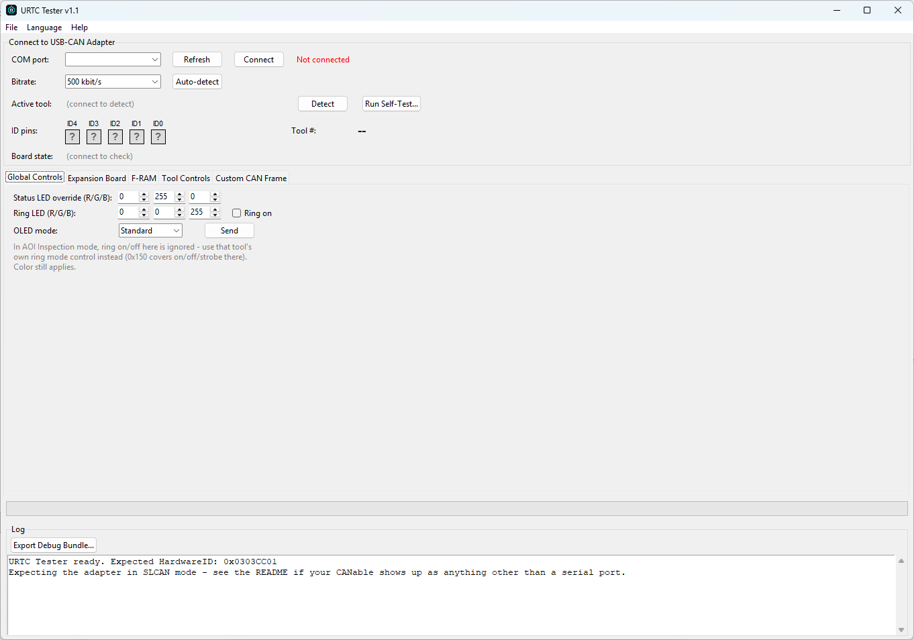

<p align="center">
  
</p>

# URTC Tester (Windows / Linux)

<p align="center">
  <a href="README.md">🇺🇸 English</a> |
  <a href="README_spa.md">🇪🇸 Español</a> |
  <a href="README_fra.md">🇫🇷 Français</a> |
  🇮🇹 <b>Italiano</b> |
  <a href="README_deu.md">🇩🇪 Deutsch</a> |
  <a href="README_zho.md">🇨🇳 简体中文</a> |
  <a href="README_jpn.md">🇯🇵 日本語</a> |
  <a href="README_por.md">🇵🇹 Português</a>
</p>


<p align="center">
  
  
  
  
</p>


**Versione:** 0.4.1 · **Autore:** JuanenRac (Electro Hobby 3D) &lt;electrohobby3d@gmail.com&gt;

Licenza: **GPL-3.0-or-later** per il codice sorgente, **CC BY-SA 4.0** per questa
documentazione - vedi `LICENSE` in questo repository, o la sezione
"Licenza e Note sul Copyright" alla fine di questo documento.

Un esercitatore live del bus CAN per la scheda URTC. Si connette tramite
lo stesso adattatore USB-CAN usato dal flasher, chiede alla scheda per
quale dei suoi 25 profili strumento è attualmente configurata via jumper,
e mostra solo i controlli e la telemetria propri di quello strumento -
non una singola finestra che cerca di rappresentare tutti e 25 insieme.
Tutto ciò che fa è un comando runtime o una lettura di telemetria contro
l'applicazione in esecuzione; non tocca mai la flash, quindi non c'è
nulla qui che possa lasciare la scheda meno funzionante di come ha
iniziato.

**Verifica di onestà - cosa funziona davvero oggi:** gli encoder di payload CAN per le famiglie di controllo migrate a Qt Quick (`advanced_protocol.py`) sono reali e coperti dai test in `tests/` (`python -m pytest -q`). Anche la CI di questo repository (`.github/workflows/ci.yml`) li esegue, insieme a `ruff check`, `tools/ci_validate.py`, una compilazione di sintassi di ogni file `.py` e i quattro script `verify_qt_*.py`, quindi una regressione lì fa fallire la build. I quattro script `verify_qt_*.py` nella radice del repository (`verify_qt_custom_frame.py`, `verify_qt_telemetry_watch.py`, `verify_qt_utility_panels.py`, `verify_qt_selftest.py`) sono vere verifiche end-to-end, deliberatamente tenute fuori da `tests/`, contro un trasporto fittizio con vera consegna di segnali cross-thread - tutti e quattro passano con `QT_QPA_PLATFORM=offscreen python verify_qt_*.py`, che la CI esegue a sua volta. Questo è il tetto onesto di ciò che viene verificato automaticamente: il livello di trasporto, la gestione ID/layout dei byte CAN, e la logica del ponte Qt Quick sono reali ed esercitati contro trame simulate, non hardware reale - come già dice "Known limitations" più sotto, questo è stato costruito senza accesso USB, quindi niente qui è stato ancora verificato contro una scheda reale. `qt_tester.py` e `assets/qml/TesterDeck.qml` sono l'implementazione reale e sostanziale (migliaia di righe combinate), esercitata dai test con schede simulate e dagli script di verifica, mai da una scheda reale.

> **Stato di sicurezza (safety e security):** questo ecosistema non è un sistema di sicurezza certificato e non esiste ancora alcuna scheda URTC assemblata. I bootloader controllano le immagini firmware con CRC32 e un HMAC-SHA256 a chiave condivisa, non con una firma asimmetrica (prevista); le immagini applicative pubblicate sono firmate con la chiave pubblica di sviluppo (`signing_key_kind: dev`), quindi chiunque può produrre un'immagine accettata dal bootloader; nulla è stato trasmesso a una scheda reale. Leggi la [base di sicurezza](https://github.com/JuanenRac/URTC-DOCS/blob/main/docs/SECURITY_BASELINE.md) e il [modello delle minacce](https://github.com/JuanenRac/URTC-DOCS/blob/main/docs/THREAT_MODEL.md) prima di fidarti di qualsiasi affermazione qui per la sicurezza di una persona.

## 📋 In breve

| | |
|---|---|
| Versione | `0.4.1` |
| Maturità | Funzionale |
| Tecnologia | Python / PySide6 / Qt Quick / live CAN bus diagnostics |
| Destinazione | Il PC di chi lo usa |
| Su hardware reale | Solo simulato: provato con emulatori, test double o simulatori; per questa versione non risulta alcuna esecuzione su hardware reale |

## 1. 🆚 Relazione con il flasher

Questo strumento e [URTC Flasher](https://github.com/JuanenRac/URTC-FLASHER) condividono lo stesso layer di
trasporto (le classi SLCAN e SocketCAN sono identiche) poiché entrambi
in definitiva devono solo far entrare e uscire trame CAN dallo stesso
tipo di adattatore, ma svolgono compiti fondamentalmente diversi:

| | Flasher | Tester |
|---|---|---|
| Tocca la flash | Sì (è tutto il punto) | Mai |
| Parla con | Il bootloader, principalmente | L'applicazione in esecuzione |
| Scopo | Aggiornare il firmware | Esercitare/verificare l'hardware reale di una testa strumento |

Se non sei sicuro di quale ti serva: se la scheda sta già eseguendo
firmware e vuoi controllare che uno strumento funzioni davvero (il
riscaldatore scalda, il motore gira, il LED si accende), vuoi questo.

## 2. 📦 Installazione ed esecuzione

Stesso schema del flasher:

```
pip install -r requirements.txt
python urtc_tester.py          # Windows
python3 urtc_tester.py         # Linux
```

Oppure compila un binario standalone: `build_exe.bat` su Windows,
`./build_exe.sh` su Linux. Entrambi puliscono prima `build/`/`dist/` e
impacchettano `assets/` (il banner e l'icona) nell'eseguibile - vedi
[docs/BUILD_AND_RUN.md](docs/BUILD_AND_RUN.md) per il percorso di
validazione senza incremento di versione (`build-test.bat`/
`build-test.sh`) su cui si basano questi script di pacchettizzazione, e
il README stesso del flasher per il ragionamento completo dietro gli
script di pacchettizzazione stessi, poiché si applica identicamente qui.

**Versionamento:** `TESTER_VERSION` (in `tester_config.py`, mostrato
nella barra del titolo, nella finestra Informazioni, nei log di sessione
e nei pacchetti di debug) segue lo schema `MAGGIORE.MINORE.PATCH`.
Entrambi gli script di build lo incrementano automaticamente subito prima
di ogni build reale tramite `bump_version.py`, con regola "odometro" in
base 10: PATCH +1, e se supera 9 si azzera e MINORE sale di 1 (es.
`0.1.9` → `0.2.0`). Eseguire dal codice sorgente (`python urtc_tester.py`)
non lo tocca mai - solo un'esecuzione reale di
`build_exe.bat`/`build_exe.sh` lo fa. MAGGIORE non sale mai
automaticamente, solo a mano. Vedi `CHANGELOG.md` per lo storico delle
versioni.

### Console visiva di controllo

La console di comando **Qt Quick** è ora quella predefinita:
~~~
python urtc_tester.py
~~~
Usa i trasporti SLCAN/SocketCAN e si avvia in sola
lettura, quindi non può trasmettere finché non vengono armati deliberatamente i
controlli attivi. Ognuno dei comandi dei 25 profili di strumento ha qui una
copertura reale e confermata (movimento, trapano, AOI, elettromagnete, impulso
di saldatura a punti/ultrasonica, getto di pasta, flying probe, ispezione
termica, i 5 attuatori con watchdog-keepalive, telemetria di vuoto/scan-probe),
tutti soggetti allo stesso controllo: una corrispondenza di identità, una
modalità attiva armata esplicitamente e una conferma dell'utente in QML prima
di trasmettere qualsiasi cosa. Nulla di tutto ciò è stato ancora verificato con una scheda reale - vedi «Limitazioni note» più sotto.

La console mostra anche i **valori in tempo reale** dello strumento rilevato (temperatura con grafico scorrevole ed esportazione CSV, giri, finecorsa; si limitano ad ascoltare, quindi funzionano in sola ascolto e accanto a un'uscita attiva), esegue l'**autotest**, avvisa nell'intestazione quando il **controllo di salute del bus** (una richiesta dello strumento attivo ogni 3 secondi finché nient'altro usa il bus) rileva un problema, e ha una finestra **Informazioni su URTC Tester** con il Readme, la Licenza e la pagina GitHub, accanto a **Salva registri...**.

L'intestazione della finestra Qt Quick ha un selettore della lingua; la scelta viene salvata e vale dal prossimo avvio. Interroga inoltre la posizione dell'alimentatore di filo del saldatore e la azzera (stima ad anello aperto; l'azzeramento chiede conferma). La sonda di identità mostra anche il numero di patch del firmware quando la scheda lo invia (firmware URTC 0.3.5 e successivi); un firmware più vecchio mostra solo maggiore.minore.

Il flusso di diagnostica CAN dal vivo esistente usa ora una superficie di controllo blu notte/ciano: intestazione di prodotto, scheda di connessione ad alto contrasto, schede degli strumenti leggibili, registro di sessione scuro e progresso visibile. Questa modifica visiva e di accessibilità non altera il monitoraggio passivo né il routing dei comandi, e nulla di tutto ciò è stato provato su una scheda reale.

### Intestazione e strumenti

- **Intestazione** - lo stato della connessione, l'avviso di salute del bus, il selettore della lingua (la scelta viene salvata e si applica al prossimo avvio) e la versione.
- **Salva registri...** e **ESPORTA SESSIONE (LOG CON HASH)** - il log a schermo come testo semplice, oppure uno zip con il log, un manifesto che lo identifica con il suo SHA-256 e la diagnostica di sistema (vedi «Registri e pacchetti di debug» più sotto).
- **Informazioni su URTC Tester** - versione e autore, con i pulsanti per **Readme** (nella lingua dell'interfaccia se esiste una traduzione), **Licenza** e la pagina **GitHub di URTC** del progetto.

### Struttura dei file

Questo strumento è organizzato in moduli per responsabilità, puramente per leggibilità - non c'è alcuna differenza funzionale tra averli come file separati o come uno grande. `tester_config.py` contiene le costanti di configurazione/lingua/protocollo, `tester_transports.py` contiene SLCAN/SocketCAN, `tester_bus_monitor.py` contiene il filtro delle trame e le statistiche del bus, `qt_tester.py` è il ponte Qt Quick (con `assets/qml/TesterDeck.qml`), `tester_selftest.py`, `tester_telemetry.py` e `tester_autodetect.py` sono la logica senza finestra di autotest, valori in tempo reale e ricerca della velocità, e `urtc_tester.py` è solo il punto di ingresso.

**Lingua**: inglese di default. Si cambia con il selettore della lingua nell'intestazione della finestra - cambia l'interfaccia (etichette, pulsanti, dialoghi, e messaggi di registro) a una qualsiasi delle 8 lingue disponibili, salva immediatamente in `config.json` accanto a
questo strumento, applicato al prossimo avvio. Le traduzioni vivono in
file di testo semplice sotto `language/` (`english.lng`, `spanish.lng`,
`italian.lng`, `french.lng`, `german.lng`, `chinese.lng`,
`japanese.lng`, `portuguese.lng`) come semplici coppie `CHIAVE=Valore`, una per riga - le righe che iniziano con `#` e le righe
vuote vengono ignorate, e un `\n` letterale dentro un valore diventa un
vero a capo (usato dalla manciata di messaggi di dialogo multi-riga).
Modificabile direttamente se una traduzione necessita correzione, o
come punto di partenza per un'altra lingua (aggiungi
`language/<nome>.lng`, aggiungi `("<nome>", "Nome Nativo")` a
`AVAILABLE_LANGUAGES` vicino all'inizio di `tester_config.py`, e imposta
`"language": "<nome>"` in `config.json`). Una chiave mancante da un file
di lingua ricade nel mostrare il nome della chiave stessa invece di
andare in crash, e un file di lingua mancante o illeggibile (modifica
errata, nome file sbagliato) ricade sull'inglese per l'intera interfaccia
- in entrambi i casi lo strumento resta usabile mentre si risolve il
disallineamento.

**Configurazione SLCAN/SocketCAN su Linux** (reflash dell'adattatore,
permessi seriali, attivazione con `ip link`) è esattamente uguale alla
sezione 1 del flasher - vedi il
[README di URTC Flasher](https://github.com/JuanenRac/URTC-FLASHER)
sezioni 1 e 2 invece di duplicarlo qui.

## 3. ⚙️ Come funziona

La finestra è disposta in 3 colonne: sinistra e centro contengono le
sezioni sempre visibili qui sotto (1-4, poi 6), destra contiene il
pannello per strumento della sezione 5, che è l'unica parte della
finestra che effettivamente cambia in base a cosa viene rilevato.
Dividere le sezioni sempre visibili su 2 colonne invece di impilarle
tutte in una mantiene la finestra dal crescere abbastanza in altezza da
non stare in uno schermo ordinario, man mano che più di queste sezioni
sono state aggiunte nel tempo. Il pannello stesso della stampante 3D (il
più alto dei 25) va un passo oltre e divide i propri controlli in 2
sottocolonne internamente, per lo stesso motivo. Vedi
[docs/ARCHITECTURE.md](docs/ARCHITECTURE.md) per la guida
all'architettura a livello di modulo che questa sezione riassume.

**Connetti** (sezione 1, identica al flasher): scegli Seriale/SLCAN o
SocketCAN, la porta/interfaccia, opzionalmente auto-rileva il bitrate,
poi Connetti.

**Il rilevamento avviene automaticamente alla connessione** (o clicca
**Rileva** per ripeterlo): lo strumento invia `0x110` (interroga
strumento attivo) e `0x7F8` (interroga versione), e usa la risposta
per:
- Mostrare quale dei 25 profili strumento è attivo, e lo stato generale
  della scheda (qualsiasi errore dichiarato, guasto bus CAN, ancora
  nella schermata di avvio).
- Mostrare l'HardwareID e la versione firmware riportati, segnalando
  una discrepanza se non corrisponde al proprio `THIS_HARDWARE_ID` di
  questo progetto.
- Costruire il pannello **Controlli Strumento** a destra per quello
  strumento specifico - e solo quello strumento. Cambiare quale
  strumento è jumperato e rilevare di nuovo smonta il vecchio pannello e
  ne costruisce uno nuovo da zero.

**Controlli Globali** (sezione 2, sempre visibile indipendentemente da
quale strumento è attivo): l'override del colore del LED di stato, il
colore e accensione/spegnimento dell'anello LED, e la modalità display
OLED (`0x100`) - questi si applicano a ogni strumento, quindi non si
spostano nel pannello dinamico. In modalità Ispezione AOI nello
specifico, l'accensione/spegnimento dell'anello qui viene ignorato a
favore del controllo strobo proprio di quello strumento (secondo
[docs/CANBUS.md](docs/CANBUS.md)) - il colore si applica comunque in entrambi i casi.

**Scheda di Espansione** (sezione 3, sempre visibile): il bus SPI
generico e la linea DIAG0 proprio di `CONN_EXPANSION` - il passthrough
grezzo condiviso da tutte le varianti di scheda di espansione con
driver. L'ADS1115 e i sensori MLX9064x, e il driver proprio
dell'attuatore di crimpatura, non si controllano da qui - vivono
all'interno del pannello del proprio strumento invece (Sonda Volante,
Ispezione Avanzata PCB, Attuatore di Crimpatura - vedi sezione 4 sotto),
poiché quale di essi si applica realmente dipende da quale profilo
strumento è configurato via jumper.

**F-RAM di Persistenza** (sezione 4, anch'essa sempre visibile, ma
deliberatamente separata da Scheda di Espansione sopra): la FM24CL64B
condivide il bus I2C2 hardware proprio dell'OLED - un componente
centrale della scheda, non qualcosa cablato a `CONN_EXPANSION` affatto.
Raggruppare i due insieme implicherebbe una connessione tra loro che
non è reale - il connettore di espansione stesso non ha F-RAM, né
EEPROM, niente di non volatile su di esso.
- **Passthrough SPI**: digita byte hex separati da spazi (1-7 di essi,
  es. `01 02 03`), premi Invia, e vedi esattamente cosa è tornato su
  MISO durante quello stesso trasferimento (`0x180`/`0x181`) - un
  trasporto di byte grezzo, non consapevole dei registri TMC5160, come
  l'approccio proprio del firmware. Utile per esercitare il bus stesso
  prima che valga la pena costruire un pannello dedicato per il
  protocollo di registri di una specifica scheda di espansione.
- **Livello DIAG0**: **Interroga DIAG0** legge lo stato attuale della
  linea di diagnostica stall/guasto di un TMC5160 (`0x182`/`0x183`) -
  HIGH (inattivo) o LOW (asserito). Una semplice lettura polled, non un
  valore live/spinto - premi di nuovo il pulsante per aggiornarlo.
- **F-RAM di Persistenza**: **Interroga Stato** rilegge ciò che la
  scheda ha salvato l'ultima volta prima di una perdita di alimentazione
  (`0x190`/`0x191`) - quale strumento era, il setpoint, se un errore
  critico era attivo in quel momento. **Cancella F-RAM...** la cancella
  (`0x192`, con un dialogo di conferma prima - questo non può essere
  annullato).
- **Tipo scheda di espansione**: **Interroga** mostra quale delle 7
  configurazioni possibili di `CONN_EXPANSION` è attualmente impostata
  (`0x1A1` - vedi `EXPANSION.TXT`). Sola lettura qui - impostala dalla
  sezione CAN OTA propria di `URTC Flasher` invece, poiché è un passo
  di configurazione hardware una tantum, non qualcosa da cambiare con
  leggerezza da uno strumento diagnostico live.
- **Variante sensore MLX9064x**: **Interroga** mostra quale dei 3
  sensori termici della famiglia MLX9064x (o nessuno) è attualmente
  configurato (`0x1A7` - vedi `CANBUS.md`) - rilevante solo quando il
  tipo di scheda di espansione sopra è una variante Advanced o
  Basic+MLX9064x. Sola lettura qui, stesso ragionamento del tipo di
  scheda di espansione sopra.
- **Configurazione libera dello strumento**: **Interroga** mostra la
  lettura grezza dei jumper ID (0-31) accanto a ciò che dice
  attualmente il registro `free_tool_selection` della F-RAM (`0x1A3` -
  vedi `EEPROM.TXT` sezione 5) - consultato effettivamente solo da una
  scheda i cui jumper leggono 0x1F/11111b. Sola lettura qui, stesso
  ragionamento del tipo scheda di espansione sopra - `URTC Flasher` è
  l'unico strumento che lo scrive.
- **Tipo periferica e numero di serie**: **Interroga** mostra il tipo
  di periferica fisso (sempre URTC/0x03) accanto al numero di serie del
  dispositivo attualmente impostato (`0x1A5` - vedi `EEPROM.TXT`
  sezione 6), un'etichetta assegnata dall'utente per distinguere più
  schede altrimenti identiche sullo stesso bus CAN. Sola lettura anche
  qui - `URTC Flasher` scrive il numero di serie, questo strumento lo
  legge solo indietro.

**Trama CAN Personalizzata** (sezione 6, anch'essa sempre visibile):
un'immissione di ID grezzo + byte hex con invio singolo e periodico -
per un comando che non ha ancora un proprio controllo qui, o per
testare qualcosa non (o non ancora) documentato in `docs/CANBUS.md`.
Nessuna validazione oltre all'intervallo ID e DLC≤8; qualsiasi cosa
questo invii è esattamente ciò che va sul bus. La stessa sezione apre
anche il **Monitor Bus Grezzo** (vedi sotto).

**Esegui Autotest** (accanto a Rileva): esegue un piccolo insieme di
controlli di comunicazione sicuri e a riposo per lo strumento
attualmente rilevato - conferma che sia l'interrogazione strumento
attivo che quella versione rispondano, poi (per strumenti con
telemetria) invia un setpoint/velocità/potenza sicuro di 0 e controlla
che arrivi la telemetria attesa. Deliberatamente non invia mai nulla
che effettivamente riscaldi, spari, o giri a potenza significativa -
questo verifica che il giro di comunicazione funzioni, non che un
attuatore risponda fisicamente, poiché confermare ciò richiede comunque
un umano che osserva. Chiede conferma prima di inviare qualsiasi cosa.
Gli strumenti senza telemetria (movimento semplice) o che sono
puramente guidati da eventi (sonda di scansione) ricevono una nota solo
informativa invece di un vero superato/fallito. **La copertura è
parziale**: solo 7 dei 25 strumenti hanno un passo di autotest definito
(saldatore, trapano, laser, stampante 3D, AOI, vuoto, sonda di
scansione) - gli altri 18 strumenti non eseguono alcun controllo quando
si preme questo pulsante.

**Grafici di temperatura live**: sia i pannelli del saldatore che
dell'ugello della stampante 3D mostrano un piccolo grafico a linee
scorrevole accanto alla loro lettura di temperatura live - un semplice
Canvas di Qt Quick, non una nuova dipendenza (matplotlib/
pyqtgraph romperebbero la politica di dipendenza zero di questo
strumento oltre pyserial). Scala asse Y fissa (0 fino al tetto di
setpoint proprio di quello strumento) invece di auto-scala, così il
trend è facile da leggere a colpo d'occhio invece che la scala si
sposti sotto di esso.

**Monitor Bus Grezzo** (aperto dalla sezione Trama CAN Personalizzata):
una finestra separata che mostra ogni trama vista, qualsiasi ID,
indipendente dal pannello strumento attivo - una tabella a scorrimento
live (Tempo/ID/DLC/Dati/Δt), Pausa/Pulisci, e una lettura approssimativa
di carico bus/frequenza trame (aggiornata una volta al secondo; la
cifra di carico non modella l'overhead di bit-stuffing, quindi trattala
come una cifra diagnostica approssimativa, non una misurazione
certificata). **Esporta .trc...**/**Esporta .asc...** salvano la
tabella attualmente mostrata come file di traccia semplificato in stile
PEAK PCAN-View / Vector CANalyzer rispettivamente - abbastanza vicino
da essere leggibile dalla maggior parte degli strumenti che si
aspettano quei formati, non garantito byte-identico a ciò che
producono le applicazioni reali. Se `urtc_custom_ids.json` esiste
accanto a questo script (opzionale, non incluso di default -
`{"0x199": "My Sensor"}`), la colonna ID mostra quel nome amichevole
accanto all'ID hex grezzo - utile per chiunque stia testando il
traffico proprio di una scheda di espansione personalizzata senza
bisogno di modificare il codice sorgente di questo strumento.

## 4. 🧰 Copertura strumenti

Ognuno dei 25 profili ha il proprio pannello, costruito direttamente da
`docs/CANBUS.md`:

| Strumento | Controlli | Telemetria live |
|---|---|---|
| Saldatore | Temperatura di setpoint, accensione/spegnimento; alimentatore stagno direzione + conteggio passi (movimento singolo); interrogazione e azzeramento a 0 della posizione dell'alimentatore | Temperatura reale; posizione alimentatore (stima ad anello aperto) |
| Dispenser Pasta/Liquido, Cacciavite, entrambi i Gripper, SMT Pick & Place, Vacuum Gripper (LG) | Direzione + conteggio passi (movimento singolo) | nessuna (0x120 condiviso, nessuna telemetria per nessuno di questi 7) |
| Prelievo a Vuoto | nessuno | Lettura analogica, pezzo rilevato |
| Trapano | Velocità + direzione | RPM reale, endstop |
| Ispezione AOI | Modalità anello (spento/strobo/continuo) + periodo strobo | Endstop |
| Incisore Laser | Potenza + armato/sicuro del blocco laser (un'uscita del firmware, non un interblocco hardware) | Endstop |
| Stampante 3D | Setpoint ugello, direzione/passi estrusore, potenza ventola strato, potenza ventola hotend | Temperatura hotend, RPM ventola strato, RPM ventola hotend |
| Sonda di Scansione | nessuno | Conteggio eventi impatto + timestamp (`0x095` a massima priorità) |
| Elettromagnete | Casella energizza/rilascia bobina | nessuna |
| Saldatrice a Punti | Durata impulso + Spara | nessuna (spara solo se il sensore di contatto legge HIGH prima - vedi il proprio `0x1C0` in `docs/CANBUS.md`) |
| Rivestimento Conformale, Inseritore a Pressione | nessuno - pannello solo informativo | nessuna - entrambi gli ID strumento non hanno alcun gestore CAN, il proprio attuatore e sensore vivono sulla scheda madre del robot stesso, vedi `docs/TOOLS.TXT` |
| Sonda Volante | La lettura base è automatica; la lettura avanzata richiede una parola di config ADS1115 grezza (hex) + Avvia Conversione + Leggi Risultato | Lettura base ADC integrato (automatica, `0x243`) |
| Cura UV | Cursore potenza (0-255) + Invia/Spegni | nessuna |
| Aria Calda per Retrofitting | Temperatura di setpoint, potenza ventola, accensione/spegnimento | Temperatura live (condivide la propria telemetria `0x135` e il grafico live del saldatore - stesso ciclo termico fisico) |
| Attuatore di Crimpatura | Direzione + conteggio passi (movimento singolo, stessa forma degli strumenti di movimento condivisi sopra, ma raggiunge il driver di una scheda di espansione via `0x1F0` invece dello `0x120` integrato) | nessuna |
| Ispezione Avanzata PCB | Avvia Acquisizione, Controlla Stato, Leggi Immagine Termica | Tela mappa di calore 32x24 pixel (gradiente blu-rosso), estratta chunk per chunk via CAN su richiesta - non è un feed video live, vedi sezione 6 sotto |
| Jetting Pasta Saldante | Canale PWM + frequenza (Configura), poi ciclo + durata (Spara Impulso) | nessuna |
| Saldatrice a Ultrasuoni | Durata impulso + Spara | nessuna (stessa forma della Saldatrice a Punti, ma senza il gate del sensore di contatto) |

**I watchdog di comunicazione sono gestiti per te.** Il saldatore,
l'Aria Calda per Retrofitting (condivide lo stesso ciclo termico e
watchdog del saldatore), il laser, e l'ugello della stampante 3D hanno
ciascuno un watchdog di 250ms nel firmware; la ventola dello strato ne
ha uno di 1000ms. Spuntare la relativa casella "Attivo" non invia
semplicemente il comando una volta - lo reinvia automaticamente (150ms
per gli strumenti con watchdog 250ms, 400ms per la ventola dello
strato) finché la casella rimane spuntata, allo stesso modo in cui un
vero controller master deve fare. Deselezionarla invia una singola
trama zero/spento e si ferma. La ventola hotend non ha watchdog (un
rilevatore di stallo invece - vedi `docs/CANBUS.md`), quindi è un
semplice invio singolo.

**Note di comodità (utilità software, non funzioni di sicurezza).**

- **FERMA TUTTE LE USCITE** (in entrambe le finestre, disponibile a connessione stabilita e con i controlli attivi armati) invia tutti i comandi di spegnimento noti - riscaldatori, laser, trapano, lampada UV, ventola di strato, rilascio dell'elettromagnete, motori passo-passo semplici e crimpatrice - qualunque sia lo strumento montato, e ferma ogni refresh. La ventola dell'hotend viene lasciata accesa di proposito, perché l'ugello potrebbe essere ancora caldo. È un comando software inviato sul bus CAN, non un arresto di emergenza: non può agire se il bus, l'adattatore, il PC o la scheda si guastano.
- Gli impulsi di saldatura singoli, l'impulso di pasta e la crimpatura chiedono conferma anche nella finestra classica, come fa sempre il deck Qt Quick.
- Il trapano e la lampada UV vengono rinfrescati come il laser e i riscaldatori. Finché il riscaldatore della stampante 3D è mantenuto, il suo refresh di 150 ms porta 0 passi di estrusore, che il firmware legge come ordine di arresto: un movimento dell'estrusore avviato in quello stato viene annullato entro 150 ms, quindi muovi l'estrusore con il riscaldatore spento finché il firmware non offrirà una modalità che lo lasci in pace.
- La porta e la velocità vengono ricordate per la sessione successiva (`config.json`) e il deck Qt Quick ha un proprio selettore di velocità. Il **rilevamento automatico** prima ascolta soltanto a ogni velocità (su un bus attivo non si trasmette nulla) e interroga a ogni velocità solo quando il bus è completamente silenzioso.
- Il Monitor del bus grezzo può essere limitato ad alcuni ID CAN (**Filtro ID**) e ai frame i cui dati sono cambiati (**Solo variazioni**).

### 🔥 Test al banco della fuga termica (firmware URTC 0.3.2+ / 0.3.3+)

Detect ora mostra *perché* una scheda ha bloccato un errore: il byte 4 di
`0x111` (protezione dalla fuga termica: MAXTEMP, HEATING_NO_RISE o
DROPPED_AT_TARGET) compare nello stato della scheda, e un reset causato dal
watchdog hardware (byte 5 di `0x111`) viene registrato nel log. **Contatori
termici** (pannello F-RAM in entrambe le interfacce) legge `0x1AA`/`0x1AB`:
guasti termici totali, ore totali di riscaldatore acceso e ultimo guasto. Le
risposte di firmware più vecchi (`0x111` a 4 byte, nessun `0x1AB`) vengono
mostrate come "non riportato", mai come zero. La procedura passo passo per
verificare la protezione su una scheda reale è in
[`docs/THERMAL_RUNAWAY_BENCH_TEST.md`](docs/THERMAL_RUNAWAY_BENCH_TEST.md).

## 5. 📋 Registri e pacchetti di debug

Come il flasher: un registro di sessione con marca temporale viene
scritto automaticamente in `logs/` (sicuro da
eliminare), ed **Esporta Pacchetto Debug** salva uno `.zip` con il
registro attuale a schermo più diagnostica di base del sistema (SO,
versione Python, trasporto/porta/bitrate attuale, strumento rilevato)
per consegnare a chi sta facendo debug di un problema di testa
strumento.

### 🤖 Senza finestra: piani di prova

`python urtc_tester.py --headless COMANDO` esegue il tester senza finestra, per una linea di produzione, uno script di banco o un lavoro di CI: `info` (chi risponde: utensile, firmware, stato rapido), `selftest`, `run-plan FILE` e `validate-plan FILE`. Un piano è un breve file JSON di passi nella cartella `plans/` (attendere un utensile, nessun guasto, una versione minima del firmware, l'autotest, un frame il cui valore sta in un intervallo, un'attesa, una domanda alla persona al banco). Il comando scrive un registro di ogni frame e un record di risultato che nomina il registro tramite il suo SHA-256, lo stesso record del pannello. Un piano invia solo interrogazioni a meno che dica `"actuation": true` e l'operatore aggiunga `--allow-actuation`; i frame del bootloader, di aggiornamento, di configurazione e di cancellazione non vengono mai inviati, un comando che il firmware abbandona se non viene rinfrescato (un riscaldatore, un trapano, un laser) può essere ripetuto mentre il piano attende (`keepalive_ms`), e dopo un piano che ha comandato qualcosa tutte le uscite vengono spente di nuovo. `--transport simulate` riproduce una testa utensile simulata e `--transport replay --port FILE` una traccia `.trc` o `.asc` registrata, così un piano si può provare senza scheda. Codice di uscita: 0 superato, 1 una verifica è fallita, 2 il piano o gli argomenti sono errati, 3 la prova non ha potuto essere eseguita. Il testo stampato è in inglese, come la riga di comando del flasher. Dettagli in [`docs/HEADLESS.md`](docs/HEADLESS.md). Nulla di tutto ciò è stato eseguito su una scheda reale.

**Cerca aggiornamenti.** Il pulsante «Cerca aggiornamenti» interroga GitHub una volta sull'ultima release e propone il download solo se contiene un pacchetto per questo sistema più recente della versione installata. Il pacchetto è accettato solo se SHA-256 e firma Ed25519 (la chiave delle release, fissata nel programma) sono validi; viene installato solo dopo la tua conferma, mai finché un'uscita è attiva, e la versione precedente è conservata per tornare indietro (e ripristinata da sola se la nuova non si avvia). Nulla viene mai controllato o installato da solo: il controllo all'avvio è un'opzione, spenta per impostazione predefinita, e la conferma si disattiva solo nella stessa finestra dopo un avviso.

**Riproduci una traccia registrata.** «Apri traccia» carica una traccia `.trc` o `.asc` (quelle che esporta il monitor del bus, o di PCAN-View e CANalyzer) e ne riproduce i frame ricevuti in un elenco proprio, marcati REPLAY, da 0,25x a 10x, con pausa, stop e ripetizione; un silenzio di oltre due secondi viene accorciato. Una riproduzione non trasmette mai, non risponde mai a una richiesta, non si mescola mai con il monitor del bus né con la sua esportazione, e non parte finché una scheda è collegata (si mette in pausa da sola se ne colleghi una). Un file oltre 50 MB o senza frame ricevuti viene rifiutato e lo dice.

**Visualizzatore della scatola nera.** La registrazione letta dalla scheda, e ogni registrazione salvata prima (`.json` o `.csv` scritti da questo programma, aperti con «Apri una registrazione salvata», senza scheda), viene disegnata come temperatura misurata e setpoint nel tempo, con un segno dove il flag di errore è stato alzato per la prima volta, ed elencata campione per campione con i flag in parole. Ogni campo deve essere un intero nell'intervallo e una registrazione ha al massimo 67 campioni; un file che non è una registrazione viene rifiutato con il motivo e il disegno precedente resta.

**Senza hardware:** una scheda virtuale fa le veci dell'adattatore e della scheda. Avvia `python -m urtc_can.virtual_board` e passa il suo URL seriale come porta (`--transport serial --port socket://127.0.0.1:7777`); la scheda risponde alla richiesta di versione e allo stato rapido come un'applicazione, così `info` e i piani di sole richieste girano da capo a fondo senza nulla collegato. È un modello scritto dalla descrizione del protocollo, non una testa utensile: l'autotest di un utensile segnala ciò che non riesce a leggere.

## 6. ⚠️ Limitazioni note

Il contratto di evidenza di questo strumento - cosa conta come
pass/fail/unknown, perché l'assenza di evidenza è sempre unknown e mai
pass, e perché di per sé non concede alcuna autorità di flashing del
firmware - è documentato in
[docs/INTEGRATION_CONTRACT.md](docs/INTEGRATION_CONTRACT.md).

- **Non testato contro hardware reale.** Ogni pezzo qui - il layer di
  trasporto, la gestione ID CAN/layout byte, la temporizzazione
  keepalive del watchdog - è stato controllato in isolamento (trame
  simulate, un sottoprocesso reale per la temporizzazione dove
  rilevante) ma l'ambiente che ha costruito questo non ha accesso USB.
  Tratta una prima sessione reale con la stessa cautela che il README
  stesso del flasher richiede.
- **Un pannello strumento alla volta, per design**, non una limitazione
  attuale da rimuovere più avanti - vedi l'introduzione sopra per il
  motivo.
- **I colori LED globali sono un override diretto**, non una rilettura
  live - non c'è telemetria di cosa stanno effettivamente mostrando in
  questo momento i LED di stato/anello, solo cosa è stato comandato
  l'ultima volta.
- **L'immagine termica propria dell'Ispezione Avanzata PCB è basata su
  estrazione, non un feed live.** Leggere un frame completo significa
  richiedere tutti i 48 chunk sequenzialmente via CAN (caso peggiore,
  la risoluzione propria di MLX90640/MLX90642) - questo può richiedere
  alcuni secondi, e non esiste una modalità di invio in streaming nel
  protocollo CAN proprio di questo strumento per renderlo più veloce.
  Prima va avviata un'acquisizione; Leggi Immagine Termica attende poi fino a due secondi che il sensore segnali di essere pronto e, se non lo fa, non legge nulla, perché il firmware non risponde alle richieste di chunk prima di quel momento. Si chiede prima quale sensore è installato (48 chunk per MLX90640/MLX90642, 12 per MLX90641), e un chunk perso lascia i suoi pixel vuoti invece di spostare il resto dell'immagine.
- **Esegui Self-Test copre solo 7 dei 25 strumenti** (saldatore,
  trapano, laser, stampante 3D, AOI, vuoto, sonda di scansione) - vedi
  "Come funziona" sopra per la spiegazione completa. Gli altri 18
  strumenti non ricevono alcun controllo automatico da quel pulsante;
  verificarli significa comunque osservare come l'hardware reale
  risponde ai controlli del proprio pannello.

## 📂 Struttura del Repository

```
/
├── urtc_tester.py             Punto di ingresso - avvia la console Qt Quick
├── qt_tester.py                Front end Qt Quick - command deck reale predefinito, in sola lettura per impostazione predefinita
│                                limitato, di sola lettura per default
├── tester_config.py            Costanti di configurazione/lingua/protocollo (ID
│                                CAN, nomi strumenti, MOTION_TOOL_IDS,
│                                AVAILABLE_LANGUAGES, EXPANSION_BOARD_TYPES)
├── tester_transports.py        Classi di trasporto SLCAN e SocketCAN
├── tester_bus_monitor.py       Thread di lettura CAN in background (CANBusMonitor)
├── tester_autodetect.py        Ricerca della velocità di un adattatore SLCAN
├── tester_selftest.py          Passi ed esecuzione dell'autotest (senza codice di finestra)
├── tester_plan.py              Piani di prova: validazione, esecuzione e il «tutto spento» che segue
├── tester_cli.py               Il tester senza finestra (--headless): info, selftest, run-plan
├── tester_simulator.py         Testa utensile simulata e lettore di tracce registrate
├── plans/                      Piani di prova di esempio (JSON)
├── tester_telemetry.py         Valori in tempo reale di ogni strumento e serie registrata
├── tester_trace_export.py      Scrittura delle esportazioni di trame .trc / .asc
├── urtc_ui/                    Utilità di interfaccia condivise (copia di URTC-COMMON)
├── advanced_protocol.py        Encoder puri di payload CAN per le famiglie di
│                                controlli migrate a Qt Quick - test senza hardware
├── verify_qt_custom_frame.py        Vera verifica end-to-end, fuori da tests/, del pannello Qt Quick Custom CAN Frame (necessita un vero event loop Qt)
├── verify_qt_telemetry_watch.py     Vera verifica end-to-end, fuori da tests/, della telemetria Qt Quick (Vacuum Pickup / Scan Probe)
├── verify_qt_utility_panels.py      Vera verifica end-to-end, fuori da tests/, dei pannelli utility Qt Quick (Global Controls / Expansion Board / F-RAM)
├── verify_qt_selftest.py            Vera verifica end-to-end, fuori da tests/, dell'autotest Qt Quick
├── tests/
│   └── test_advanced_protocol.py   Test senza hardware per gli encoder di advanced_protocol.py - eseguiti dalla CI, vedi Verifica di onestà sopra
├── requirements.txt            pyserial>=3.5 + PySide6>=6.8,<7
├── build_exe.bat               Script di build del binario standalone per Windows
│                                (PyInstaller)
├── build_exe.sh                Lo stesso, per Linux
├── build-test.bat              Controllo build/compilazione senza incremento di versione
├── build-test.sh                Lo stesso, per Linux
├── bump.py                     Comando esplicito per alzare la versione (compilare non la alza mai)
├── bump_version.py             Incremento di versione stile contachilometri, eseguito dagli script di build
├── bump_manifest_version.py    Sincronizza la versione di urtc.project.json con quella nativa (--sync)
├── URTC_Tester.spec            Spec di PyInstaller usato da entrambi gli script di
│                                build
├── assets/
│   ├── URTC_APP_ICON.svg       Sorgente dell'icona finestra/barra applicazioni
│                                (design standalone piccolo)
│   ├── URTC_LOGO_TESTER.svg    Sorgente del banner (vettoriale)
│   ├── HYDRA_UMC_ICON.svg      Sorgente vettoriale animata HYDRA-UMC mantenuta
│   ├── qml/
│   │   └── TesterDeck.qml      UI Qt Quick del command deck predefinito
│   ├── urtc_icon.ico           Icona Windows, generata da URTC_APP_ICON.svg
│   └── urtc_icon.png           La stessa, in formato PNG (Linux)
├── images/
│   ├── URTC_LOGO_TESTER.svg    Banner del logo mostrato in cima a questo README
│   └── URTC_TESTER_V1_1.png    Screenshot della finestra principale dello
│                                strumento (vedi Foto sotto)
├── language/
│   ├── english.lng             Lingua predefinita, stringhe KEY=Value in testo
│                                semplice
│   ├── spanish.lng
│   ├── italian.lng
│   ├── french.lng
│   ├── german.lng
│   ├── japanese.lng
│   ├── chinese.lng
│   └── portuguese.lng
├── logs/                       Log di sessione scritti qui a runtime (sicuri da
│                                eliminare)
├── LICENSE                     Testo completo della licenza - vedi Licenza e Note
│                                sul Copyright sotto
├── NOTICE                      Avviso di copyright e licenza della documentazione
├── README.md                   Versione inglese
├── README_spa.md               Traduzione spagnola
├── README_ita.md               Questo file
├── README_fra.md               Traduzione francese
├── README_deu.md               Traduzione tedesca
├── README_zho.md               Traduzione cinese
├── docs/
│   ├── ARCHITECTURE.md
│   ├── BUILD_AND_RUN.md
│   ├── INTEGRATION_CONTRACT.md
│   ├── CANBUS.md
│   └── THERMAL_RUNAWAY_BENCH_TEST.md
├── tools/
│   ├── build_test.py                     Controllo di compilazione senza incremento di versione + validazione delle sorgenti del deck Qt Quick
│   └── ci_validate.py                    Validazione manifest/CHANGELOG/docs usata dalla CI
└── README_jpn.md               Traduzione giapponese
```

## 📸 Foto

<p align="center">
  
</p>

**Registratore di guasti, funzioni opzionali, banco del rack e vista termica (nuovo, verificato solo con simulazioni):** il pannello legge la scatola nera della scheda (`0x1A8` / `0x1A9`) e la salva in CSV e JSON, automaticamente una volta per ogni errore segnalato dalla scheda quando l'opzione è attiva; attiva le funzioni opzionali del firmware (`0x1AE` / `0x1AF`, spente per impostazione predefinita, efficaci al prossimo avvio); ha un rack di utensili simulato con il protocollo seriale di URTC-SMART-RACK, l'identità di ogni testa (tipo e numero di serie) e l'esportazione di una pagina di stato; e mostra l'immagine di ispezione termica in falsi colori (un'immagine simulata lo dichiara). I nomi e i tipi degli utensili ora derivano dai profili utensile condivisi di URTC-COMMON. Nulla di tutto ciò è stato usato con una scheda reale.

**PID del riscaldatore (nuovo, verificato solo con simulazioni):** il pannello legge lo stato del PID del riscaldatore del firmware (`0x1B9` / `0x1BA`: i guadagni in vigore, lo stato e l'uscita dell'ultimo ciclo di controllo), salva i guadagni (da 0 a 600) e avvia o annulla l'autotuning a relè, che scalda la punta attorno al setpoint attuale del saldatore (da 100 a 445 C) e salva i guadagni trovati. Salvare i guadagni e avviare l'autotuning chiedono la solita conferma; annullare no. Anche la testa simulata della riga di comando (`--transport simulate`) risponde a questi frame. La funzione va prima attivata tra le funzioni opzionali; nulla di tutto ciò è stato usato con una scheda reale.

## 🔗 Progetti Correlati

Questo progetto fa parte dell'ecosistema robotico HYDRA-UMC dello stesso autore (JuanenRac / Electro Hobby 3D). Vale la pena conoscerlo, poiché una richiesta potrebbe in realtà riguardare uno di questi invece di questo repository.

**Progetto Padre**
- **[URTC](https://github.com/JuanenRac/URTC)** — firmware per la scheda fisica dell'Universal Robot Tool Controller, oltre 25 profili utensile su bus CAN; il genitore di cui questo repository è uno strumento specifico, all'interno della propria famiglia di strumenti CAN-bus.

**Progetti Fratelli** — gli altri strumenti della propria famiglia di strumenti CAN-bus di URTC
- **[URTC-FLASHER](https://github.com/JuanenRac/URTC-FLASHER)** — strumento desktop con GUI per il flashing delle schede URTC, CAN-OTA più SWD/JTAG a chip intero.
- **[URTC-GATEWAY](https://github.com/JuanenRac/URTC-GATEWAY)** — un gateway davanti al bus CAN che lascia passare solo gli identificatori di un elenco, ne limita la frequenza e chiede una chiave di sessione.
- **[URTC-WEB-STUDIO](https://github.com/JuanenRac/URTC-WEB-STUDIO)** — alternativa basata su browser a URTC-TESTER tramite la Web Serial API, senza installazione locale.

**Direttamente Correlati**
- **[HYDRA-UMC-TOOL-CLI](https://github.com/JuanenRac/HYDRA-UMC-TOOL-CLI)** — CLI di flotta con un vero e stabile contratto di exit-code, un client live reale della stessa API di HYDRA-UMC-SERVER — esegue audit a livello di flotta (il comando `audit`) su tutte le teste utensile contemporaneamente, andando oltre l'ambito a scheda singola coperto da questo tester.
- **[URTC-VISION-TOOL](https://github.com/JuanenRac/URTC-VISION-TOOL)** — firmware più un vero companion di visione Python per una testa utensile di ispezione termica/RGB — completa la diagnostica CAN-bus dal vivo di questo progetto con i propri controlli visivi di garanzia della qualità sulla testa utensile.
- **[URTC-UPDATER](https://github.com/JuanenRac/URTC-UPDATER)** — strumento desktop che rileva, installa e aggiorna i repository della famiglia URTC, con una azione esplicita alla volta.

**Fa Anche Parte dell'Ecosistema**

*Hardware e Piattaforma di Base*
- **[HYDRA-UMC](https://github.com/JuanenRac/HYDRA-UMC)** — il progetto della scheda madre del braccio robotico: host CM5 + coprocessore STM32H745 dual-core, pensato per coordinare fino a 8 bracci utensile via CAN-OTA/SPI-OTA (firmware in fase iniziale; nessuna scheda assemblata per ora).
- **[HYDRA-UMC-OS](https://github.com/JuanenRac/HYDRA-UMC-OS)** — livello prodotto riproducibile su Raspberry Pi OS per il CM5: agente in sola lettura, config/profili validati, provisioning WiFi al primo contatto.
- **[HYDRA-UMC-SDK](https://github.com/JuanenRac/HYDRA-UMC-SDK)** — il contratto JSON-Schema condiviso e la barriera software di controllo dei job contro cui ogni bridge valida i propri comandi (non è una funzione di sicurezza certificata).
- **[HYDRA-UMC-CONNECTOR-HUB](https://github.com/JuanenRac/HYDRA-UMC-CONNECTOR-HUB)** — registro dichiarativo e validatore di manifesti adattatore per connettori di macchine esterne; estende la propria idea di contratto dell'SDK alle macchine esterne senza sostituire i progetti di gateway industriale.

*Backend Centrale e Client*
- **[HYDRA-UMC-SERVER](https://github.com/JuanenRac/HYDRA-UMC-SERVER)** — il vero backend headless (REST/WebSocket) con cui parla davvero ogni client di controllo.
- **[HYDRA-UMC-STUDIO](https://github.com/JuanenRac/HYDRA-UMC-STUDIO)** — dashboard di controllo web con visualizzazione 3D multi-robot in tempo reale.
- **[HYDRA-UMC-SUITE](https://github.com/JuanenRac/HYDRA-UMC-SUITE)** — centro di comando sciame desktop (PySide6) per più server contemporaneamente, pacchettizzato come eseguibile standalone.
- **[HYDRA-UMC-ANDROID-CONTROL](https://github.com/JuanenRac/HYDRA-UMC-ANDROID-CONTROL)** — app di controllo nativa per Android con login biometrico e un companion Wear OS abbinato.
- **[HYDRA-UMC-IOS-CONTROL](https://github.com/JuanenRac/HYDRA-UMC-IOS-CONTROL)** — app di controllo per iOS/iPadOS (Flutter) con sincronizzazione WebSocket in tempo reale.
- **[HYDRA-UMC-DSI](https://github.com/JuanenRac/HYDRA-UMC-DSI)** — interfaccia touch nativa per il touchscreen DSI da 7" a bordo, incorporata direttamente nel CM5.
- **[HYDRA-UMC-EDITOR-URDF](https://github.com/JuanenRac/HYDRA-UMC-EDITOR-URDF)** — creatore/editor grafico desktop di URDF che invia i modelli finiti al catalogo di STUDIO.
- **[HYDRA-UMC-EDITOR-STL](https://github.com/JuanenRac/HYDRA-UMC-EDITOR-STL)** — editor desktop di modelli STL, che trasforma/sostituisce/rimuove/aggiunge veri pezzi nello stesso catalogo di modelli modificato anche da HYDRA-UMC-EDITOR-URDF.
- **[HYDRA-UMC-BRIDGE-AMR](https://github.com/JuanenRac/HYDRA-UMC-BRIDGE-AMR)** — barriera di coordinamento per flotte AGV/AMR tramite un publisher MQTT VDA 5050 (testato solo contro una flotta emulata).
- **[HYDRA-UMC-BRIDGE-CNC](https://github.com/JuanenRac/HYDRA-UMC-BRIDGE-CNC)** — coordinatore ad alto livello per celle CNC con accesso a stato/byte di controllo GRBL (testato solo contro un emulatore).
- **[HYDRA-UMC-BRIDGE-DROIDS](https://github.com/JuanenRac/HYDRA-UMC-BRIDGE-DROIDS)** — barriera di coordinamento per droidi con zampe/umanoidi, con un mittente di comandi per Boston Dynamics Spot (testato solo contro un emulatore).
- **[HYDRA-UMC-BRIDGE-LASER](https://github.com/JuanenRac/HYDRA-UMC-BRIDGE-LASER)** — coordinatore per celle laser che legge 3 segnali GPIO di chiave/involucro/interblocco (testato solo contro un chip simulato; non può armare né far partire un laser).
- **[HYDRA-UMC-BRIDGE-OPENPNP](https://github.com/JuanenRac/HYDRA-UMC-BRIDGE-OPENPNP)** — coordinatore ad alto livello sicuro per il flusso schede del pick-and-place OpenPnP.
- **[HYDRA-UMC-BRIDGE-PRINTER3D](https://github.com/JuanenRac/HYDRA-UMC-BRIDGE-PRINTER3D)** — barriera di coordinamento sicura per stampanti 3D Moonraker/Klipper, con comandi di lavoro reali e controllati.
- **[HYDRA-UMC-BRIDGE-ROS2](https://github.com/JuanenRac/HYDRA-UMC-BRIDGE-ROS2)** — coordinatore con un trasporto ROS 2 rclpy importato in modo lazy (non ancora eseguito contro un'installazione ROS 2).
- **[HYDRA-UMC-BRIDGE-UAV](https://github.com/JuanenRac/HYDRA-UMC-BRIDGE-UAV)** — barriera di coordinamento per UAV dotati di fotocamera, con un mittente di comandi MAVLink (testato solo contro un emulatore).

*Nodo IA Visione (Hailo-8)*
- **[HYDRA-UMC-VISION-NODE](https://github.com/JuanenRac/HYDRA-UMC-VISION-NODE)** — hub di integrazione per la pipeline di visione Hailo-8, con un vero controllo di prontezza hardware per fase.
- **[HYDRA-UMC-DETECTION-HEF](https://github.com/JuanenRac/HYDRA-UMC-DETECTION-HEF)** — registro reale di modelli compilati con verifica di caricamento sicuro per architettura Hailo/checksum.
- **[HYDRA-UMC-VISION-STREAMER](https://github.com/JuanenRac/HYDRA-UMC-VISION-STREAMER)** — generatore reale di pipeline GStreamer + config MediaMTX, con una vera barriera di integrazione HailoRT.
- **[HYDRA-UMC-VISUAL-SERVOING-API](https://github.com/JuanenRac/HYDRA-UMC-VISUAL-SERVOING-API)** — legge di correzione Position-Based Visual Servoing con autorizzazione condizionata allo stato di zona; ancora nessuna stima di posa da telecamera.
- **[HYDRA-UMC-SAFETY-ZONES](https://github.com/JuanenRac/HYDRA-UMC-SAFETY-ZONES)** — logica v0 di violazione zona, freschezza di calibrazione e richiesta E-STOP che legge le posizioni degli oggetti da un file; nessun rilevatore la alimenta e nessun E-STOP fisico è ancora collegato.

*Nodo IA Cognitivo (Hailo-10)*
- **[HYDRA-UMC-COGNITIVE-NODE](https://github.com/JuanenRac/HYDRA-UMC-COGNITIVE-NODE)** — hub di integrazione per la pipeline cognitiva Hailo-10 (orchestrazione LLM/VLA/voce).
- **[HYDRA-UMC-VLA-ENGINE](https://github.com/JuanenRac/HYDRA-UMC-VLA-ENGINE)** — vera codifica/decodifica di token d'azione e generazione di traiettoria per un modello Vision-Language-Action.
- **[HYDRA-UMC-VOICE-UI](https://github.com/JuanenRac/HYDRA-UMC-VOICE-UI)** — vero front-end vocale (VAD + parser di intenti) con un relay verso Watch limitato e soggetto a conferma.
- **[HYDRA-UMC-SEMANTIC-PLANNER](https://github.com/JuanenRac/HYDRA-UMC-SEMANTIC-PLANNER)** — vera scomposizione dei task basata su regole e recupero semantico degli errori sui codici errore MCU.
- **[HYDRA-UMC-DOCS-QA](https://github.com/JuanenRac/HYDRA-UMC-DOCS-QA)** — vera ricerca documentale TF-IDF (solo libreria standard) sui documenti Markdown di questo ecosistema.
- **[HYDRA-UMC-LOCAL-TECHNICIAN](https://github.com/JuanenRac/HYDRA-UMC-LOCAL-TECHNICIAN)** — tecnico di manutenzione IA locale e con cancelli di policy per l'ecosistema stesso - osserva, diagnostica e propone correzioni; i due livelli di rischio più alti non sono deliberatamente ancora implementati.

*Orchestrazione e Sciame*
- **[HYDRA-UMC-ORCHESTRATOR](https://github.com/JuanenRac/HYDRA-UMC-ORCHESTRATOR)** — hub di integrazione con un vero contratto di health-report gRPC/Protobuf e una macchina a stati di missione.
- **[HYDRA-UMC-JOB-DISPATCHER](https://github.com/JuanenRac/HYDRA-UMC-JOB-DISPATCHER)** — vera coda di lavori basata su priorità con deduplicazione, su una vera API HTTP.
- **[HYDRA-UMC-NODE-HEALING](https://github.com/JuanenRac/HYDRA-UMC-NODE-HEALING)** — vero watchdog di salute della flotta basato su gRPC, con retry/backoff e rilevamento di discrepanza d'identità.
- **[HYDRA-UMC-PATH-PLANNER-3D](https://github.com/JuanenRac/HYDRA-UMC-PATH-PLANNER-3D)** — vero pianificatore di percorsi 3D basato su RRT, con vera validazione delle collisioni ostacolo/spazio di lavoro.
- **[HYDRA-UMC-SWARM-SYNC](https://github.com/JuanenRac/HYDRA-UMC-SWARM-SYNC)** — vera sincronizzazione di stato CRDT LWW-Element-Map, con property test per la convergenza multi-cella.

*Gemello Digitale e Simulazione*
- **[HYDRA-UMC-TWIN](https://github.com/JuanenRac/HYDRA-UMC-TWIN)** — hub di integrazione per il motore di gemello digitale, con un vero contratto di sincronizzazione per compatibilità di versione.
- **[HYDRA-UMC-HIL-BRIDGE](https://github.com/JuanenRac/HYDRA-UMC-HIL-BRIDGE)** — router hardware-in-the-loop con un interblocco software di collisione tra simulazione e hardware reale (testato senza hardware reale).
- **[HYDRA-UMC-PHYSICS-REPLICA](https://github.com/JuanenRac/HYDRA-UMC-PHYSICS-REPLICA)** — vera cinematica diretta e validazione dei limiti articolari su un vero sottoinsieme URDF.
- **[HYDRA-UMC-SYNTHETIC-DATA-GEN](https://github.com/JuanenRac/HYDRA-UMC-SYNTHETIC-DATA-GEN)** — vero generatore procedurale di scene 2D con esportazione di annotazioni YOLO/COCO.

*Dati e Analisi*
- **[HYDRA-UMC-DATALAKE](https://github.com/JuanenRac/HYDRA-UMC-DATALAKE)** — vero archivio di serie temporali basato su sqlite3, con una vera API HTTP di ingestione/query.
- **[HYDRA-UMC-ANOMALY-DETECTOR](https://github.com/JuanenRac/HYDRA-UMC-ANOMALY-DETECTOR)** — vero rilevatore di anomalie FFT + baseline statistica, con monitoraggio della deriva.
- **[HYDRA-UMC-PRODUCTION-REPORTS](https://github.com/JuanenRac/HYDRA-UMC-PRODUCTION-REPORTS)** — vero calcolo OEE/disponibilità sullo storico di DATALAKE, con esportazione CSV riproducibile.
- **[HYDRA-UMC-TELEMETRY-COLLECTOR](https://github.com/JuanenRac/HYDRA-UMC-TELEMETRY-COLLECTOR)** — vera pipeline di ingestione CAN/WebSocket verso DATALAKE, con deduplicazione per sequenza.

*Gateway Industriale*
- **[HYDRA-UMC-GATEWAY-INDUSTRIAL](https://github.com/JuanenRac/HYDRA-UMC-GATEWAY-INDUSTRIAL)** — hub di integrazione che inoltra ai protocolli industriali, con un vero livello di allowlist dei comandi/backpressure.
- **[HYDRA-UMC-OPCUA-SERVER](https://github.com/JuanenRac/HYDRA-UMC-OPCUA-SERVER)** — vero spazio di indirizzi OPC-UA, verificato con una vera sessione client del protocollo binario.
- **[HYDRA-UMC-MQTT-BROKER](https://github.com/JuanenRac/HYDRA-UMC-MQTT-BROKER)** — vero broker MQTT con autenticazione opzionale per client e ACL sui topic.
- **[HYDRA-UMC-MTCONNECT-ADAPTER](https://github.com/JuanenRac/HYDRA-UMC-MTCONNECT-ADAPTER)** — veri endpoint XML `/probe` e `/current` di MTConnect, con output in modalità degradata.

*Strumenti Complementari e Operazioni dell'Ecosistema*
- **[HYDRA-UMC-DASHBOARD-AI](https://github.com/JuanenRac/HYDRA-UMC-DASHBOARD-AI)** — pannelli Smart Summaries e Anomaly Highlighting su DATALAKE/ANOMALY-DETECTOR, con un fallback statistico onesto.
- **[HYDRA-UMC-WATCH](https://github.com/JuanenRac/HYDRA-UMC-WATCH)** — app companion WearOS con schemi di avviso aptico e un relay vocale verso il telefono abbinato (non ancora eseguita su un orologio fisico).
- **[URTC-SMART-RACK](https://github.com/JuanenRac/URTC-SMART-RACK)** — firmware per un rack di montaggio schede con decodifica reale dell'ID utensile e logica di preriscaldamento Smart Idle.
- **[HYDRA-UMC-UPDATER](https://github.com/JuanenRac/HYDRA-UMC-UPDATER)** — strumento amministrativo desktop che scopre, clona e aggiorna ogni repository di questo ecosistema.
- **[HYDRA-UMC-OS-REBUILDER](https://github.com/JuanenRac/HYDRA-UMC-OS-REBUILDER)** — strumento desktop Windows/Linux che costruisce un'immagine della CM5 pronta da scrivere, precaricata con le versioni più aggiornate dell'ecosistema, con configurazione di primo avvio Wi-Fi/utente/SSH in stile Raspberry Pi Imager.
- **[HYDRA-UMC-OPS-AGENT](https://github.com/JuanenRac/HYDRA-UMC-OPS-AGENT)** — coordinatore di incidenti di manutenzione: un ruolo edge a basso privilegio raccoglie uno snapshot di inventario/salute sanificato, un ruolo control-plane lo rende in sola lettura e chiede a un provider di IA di suggerire una diagnosi - non applica mai una patch né distribuisce nulla.
- **[HYDRA-UMC-DEV-SERVER](https://github.com/JuanenRac/HYDRA-UMC-DEV-SERVER)** — host di sviluppo riproducibile (Raspberry Pi 5 / CM5) che conserva il codice sorgente dell'ecosistema ed esegue attività delimitate di build/test tramite una coda durevole; un ruolo di sviluppo dedicato, esplicitamente distinto da un CM5 operativo.

## 📜 LICENZA

URTC Tester è (c) 2026 JuanenRac (Electro Hobby 3D). Questo avviso deve
essere incluso in qualsiasi distribuzione di questo progetto o lavoro
derivato.

Questo progetto consiste di codice sorgente e propria documentazione,
resi disponibili sotto licenze diverse - ciascuna adatta a ciò che
effettivamente copre:

1. Il codice sorgente (`urtc_tester.py` e ogni modulo `tester_*.py`) e
   qualsiasi binario compilato a partire da esso tramite
   `build_exe.bat`/`build_exe.sh` sono disponibili sotto la
   **GNU General Public License v3.0 or later (GPL-3.0-or-later)**. Testo completo su
   https://www.gnu.org/licenses/gpl-3.0.html.

2. La documentazione (questo README e le proprie traduzioni -
   `README_spa.md`, `README_ita.md`, `README_fra.md`, `README_deu.md`,
   `README_zho.md`, `README_jpn.md`, `README_por.md` e le guide in `docs/`)
   è disponibile sotto **Creative Commons Attribution-ShareAlike 4.0
   International (CC BY-SA 4.0)**. Testo completo su
   https://creativecommons.org/licenses/by-sa/4.0/.

Questo strumento è il compagno diagnostico live del bus CAN del
progetto [URTC (Universal Robot Tool Controller)](https://github.com/JuanenRac/URTC)
- vedi il repository proprio di quel progetto per il firmware della
scheda, i design hardware, e la documentazione completa del protocollo
che questo strumento esercita. Il firmware proprio di URTC è GPL-3.0-or-later e
i suoi design hardware sono CERN-OHL-S v2; la licenza propria di questo
strumento qui non si estende a quel progetto separato, e viceversa.
Esiste anche un'alternativa basata sul web che copre terreno simile su
[URTC Web Studio](https://github.com/JuanenRac/URTC-WEB-STUDIO).

Se costruisci su questo progetto, tieni presente la separazione delle
licenze: le modifiche al codice dovrebbero rimanere GPL-3.0-or-later, i derivati
della documentazione dovrebbero rimanere CC BY-SA - ciascuno con
attribuzione a questo progetto e al suo autore.

---

## 📚 Documentazione e Comunità

- **[CONTRIBUTING.md](CONTRIBUTING.md)** — stack tecnologico e linee guida di codifica per una pull request.
- **[CODE_OF_CONDUCT.md](CODE_OF_CONDUCT.md)** — gli standard di comportamento attesi in questa comunità.
- **[SECURITY.md](SECURITY.md)** — come segnalare una vulnerabilità, e le reali aree di attenzione sulla sicurezza di questo progetto.
- **[SUPPORT.md](SUPPORT.md)** — dove porre domande e segnalare bug.
- **[LICENSE.md](LICENSE.md)** — la licenza propria di questo progetto.

## 👤 AUTORE

**JuanenRac** (Electro Hobby 3D)
📧 electrohobby3d@gmail.com
📺 [youtube.com/@electrohobby3d](https://youtube.com/@electrohobby3d)
