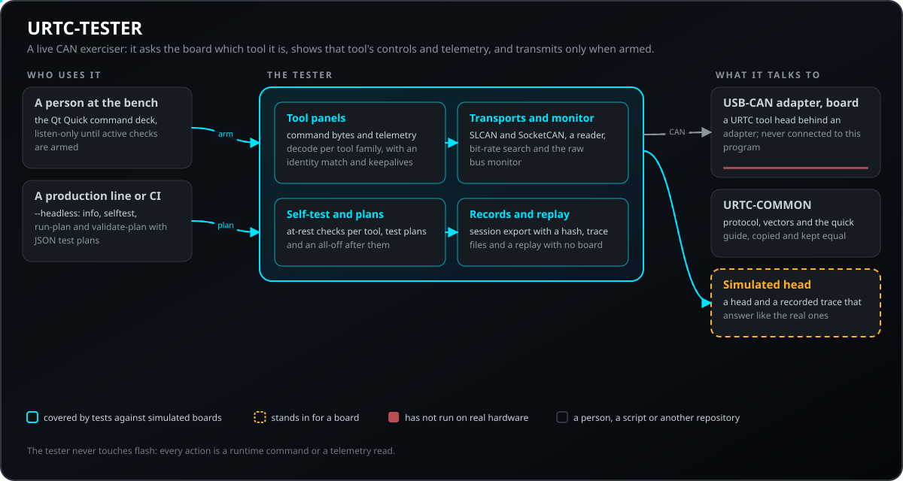
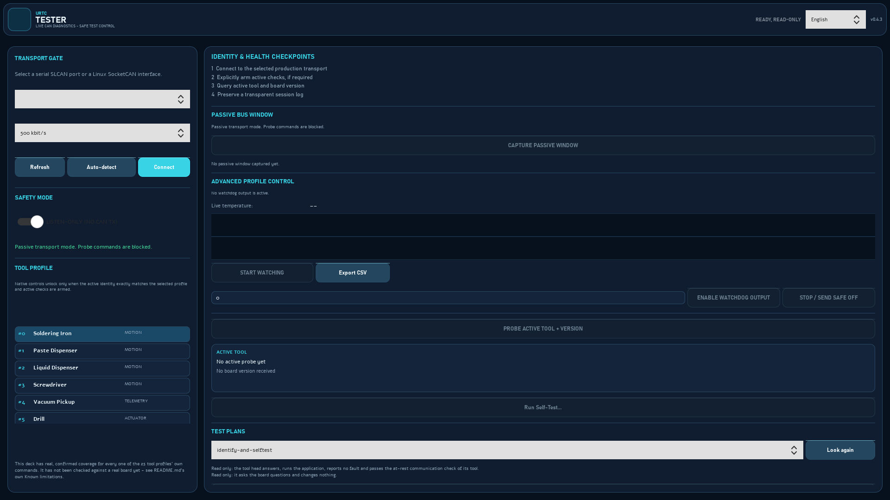
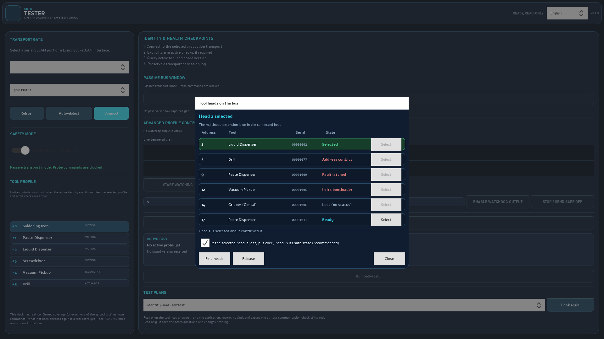
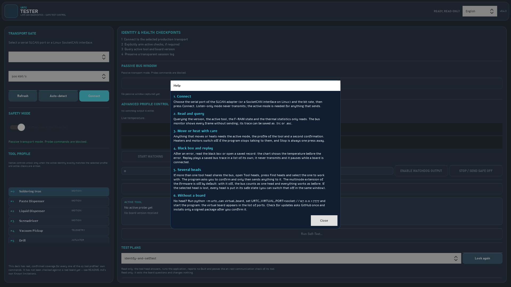
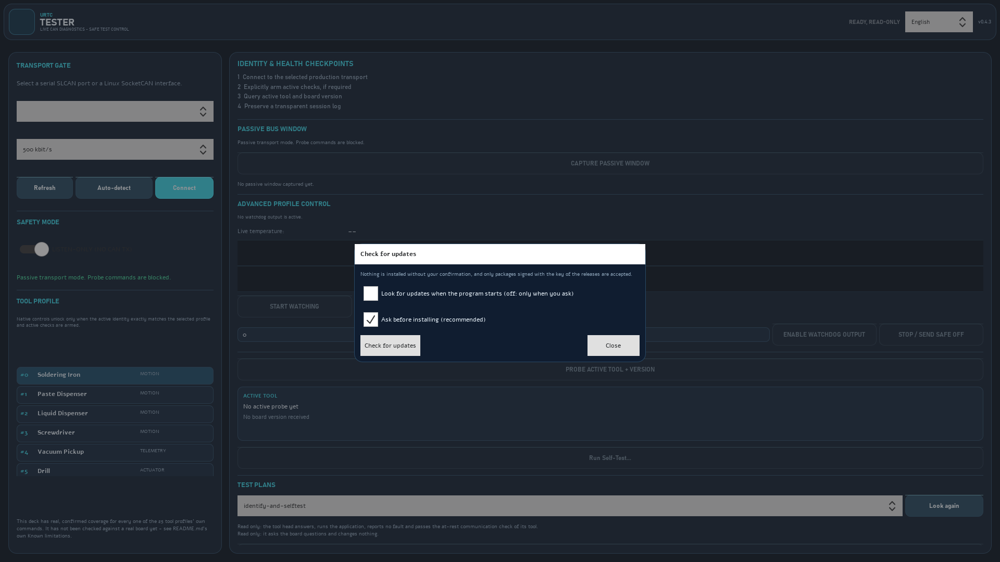
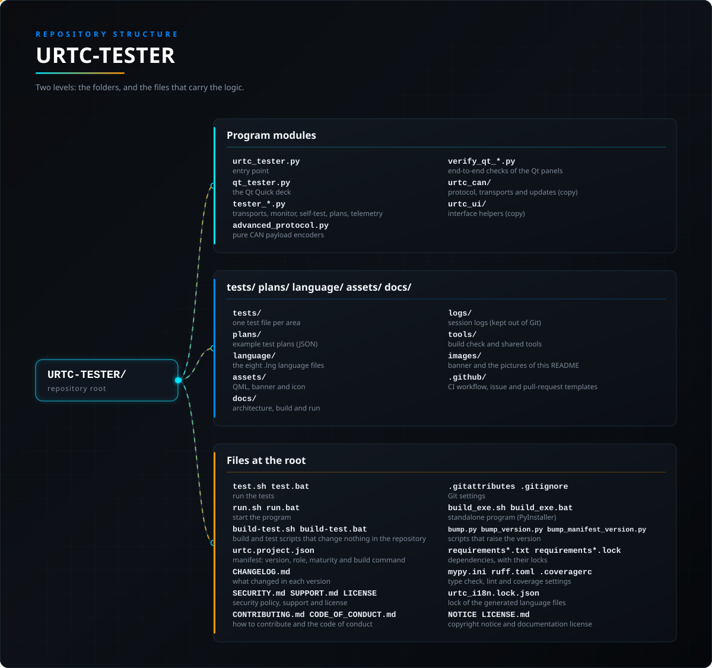

<p align="center">
  
</p>

# URTC Tester（Windows / Linux）

<p align="center">
  <a href="README.md">🇺🇸 English</a> |
  <a href="README_spa.md">🇪🇸 Español</a> |
  <a href="README_fra.md">🇫🇷 Français</a> |
  <a href="README_ita.md">🇮🇹 Italiano</a> |
  <a href="README_deu.md">🇩🇪 Deutsch</a> |
  🇨🇳 <b>简体中文</b> |
  <a href="README_jpn.md">🇯🇵 日本語</a> |
  <a href="README_por.md">🇵🇹 Português</a>
</p>

### URTC 板的实时 CAN 总线测试器：只显示已接入工具头的控件和遥测数据

<p align="center">
  
  
  
  
  
</p>

---

**诚实核查 - 今天真正能运行的部分：** 为迁移到 Qt Quick 的控制系列所提供的 CAN 负载编码器（`advanced_protocol.py`）是真实的，并由 `tests/` 中的测试覆盖（`python -m pytest -q`）。这个仓库自己的 CI（`.github/workflows/ci.yml`）也会运行它们，同时运行 `ruff check`、`python -m mypy`、`tools/ci_validate.py`、对每个 `.py` 文件的语法编译以及四个 `verify_qt_*.py` 脚本，所以那里的回归会导致构建失败。仓库根目录下的四个 `verify_qt_*.py` 脚本（`verify_qt_custom_frame.py`、`verify_qt_telemetry_watch.py`、`verify_qt_utility_panels.py`, `verify_qt_selftest.py`）是真实的、刻意放在 `tests/` 之外的端到端检查，针对一个带有真实跨线程信号传递的模拟传输层——运行 `QT_QPA_PLATFORM=offscreen python verify_qt_*.py` 时四者都能通过，CI 也会运行它们。这就是自动验证所能达到的诚实上限：传输层、CAN ID/字节布局处理，以及 Qt Quick 桥接逻辑都是真实的，并且针对模拟帧进行了验证，而不是真实硬件——正如下文"Known limitations"已经指出的，这套工具是在没有 USB 访问权限的环境下构建的，所以这里的任何东西都还没有针对真实板卡验证过。`qt_tester.py` 和 `assets/qml/TesterDeck.qml` 是真实而庞大的实现（合计数千行代码），由使用模拟板卡的测试和验证脚本检验，从未在真实板卡上运行过。

---

> **安全与安防现状:**本生态系统不是经认证的安全系统,目前也不存在已组装的 URTC 电路板。引导程序使用 CRC32 和共享密钥的 HMAC-SHA256 校验固件映像,而非非对称签名(计划中);已发布的应用映像使用公开的开发密钥签名(`signing_key_kind: dev`),因此任何人都可以生成引导程序接受的映像;尚未向任何真实电路板发送过任何内容。在依赖此处任何说法来保障人身安全之前,请先阅读[安全基线](https://github.com/JuanenRac/URTC-DOCS/blob/main/docs/SECURITY_BASELINE.md)和[威胁模型](https://github.com/JuanenRac/URTC-DOCS/blob/main/docs/THREAT_MODEL.md)。

## 📋 速览

| | |
|---|---|
| 版本 | `0.4.5` |
| 成熟度 | 可用 |
| 测试 | 633 (`python -m pytest -q`) |
| 技术栈 | Python / PySide6 / Qt Quick / live CAN bus diagnostics |
| 目标 | 使用者的电脑 |
| 真实硬件 | 仅模拟：使用模拟器、替身或仿真测试；此版本没有在真实硬件上运行的记录 |

**跳转到：** [概述](#-概述) · [架构](#-架构) · [功能](#-功能) · [安全](#-安全与防护) · [接口](#-接口) · [快速开始](#-快速开始) · [测试](#-测试) · [结构](#-仓库结构) · [相关项目](#-相关项目)

<!-- urtc-section:status_tester -->
## 🚦 项目状态

🟢 已完成并已验证 · 🟡 可用，但有已知限制 · 🟠 做了一半或未验证 · 🔴 未完成或不能用。从未在真实硬件上运行过的内容不会是绿色。

| 部分 | 状态 | 仓库能够证明的内容 |
| --- | :---: | --- |
| 软件 | 🟡 | 可在电脑上和模拟器上运行；从未在真实板子上运行过。 |
| 界面 | 🟡 | 窗口可运行，并用模拟板子检查；未用真实适配器试过。 |
| 测试 | 🟢 | 每次推送时测试套件都会在 CI 中通过。 |
| 真实硬件 | 🟠 | 尚未在真实板子上运行：台架测试仍待进行。 |
| 文档 | 🟡 | 提供八种语言的 README 和参考文档；翻译未经母语者审阅。 |

<!-- /urtc-section:status_tester -->

## 🎯 概述

一款面向 URTC 板卡的实时 CAN 总线测试器。它通过与刷写工具相同的 USB-CAN
适配器连接，询问板卡当前跳接为其 25 种工具配置文件中的哪一种，并仅显示
该工具自身的控件和遥测——而非试图用一个窗口同时表示全部 25 种。它所做的
一切都是针对当前正在运行的应用程序的运行时指令或遥测读取；它从不触碰
闪存，因此这里没有任何东西会让板卡的可用性比开始时更差。

### 与刷写工具的关系

本工具与 [URTC Flasher](https://github.com/JuanenRac/URTC-FLASHER) 共享
同一个传输层（SLCAN 和 SocketCAN 类是完全相同的），因为两者最终都只需要
让 CAN 帧在同一类适配器上进出，但它们从事的是根本不同的工作：

| | 刷写工具 | 测试器 |
|---|---|---|
| 触碰闪存 | 是（这正是它的全部意义） | 从不 |
| 通信对象 | 主要是引导程序 | 正在运行的应用程序 |
| 目的 | 更新固件 | 测试/验证工具头的实际硬件 |

如果你不确定需要哪一个：如果板卡已经在运行固件，而你想检查某个工具是否
真的能用（加热器加热、电机转动、LED 点亮），你需要的就是这一个。

## 🧩 在 URTC 中的角色

URTC-TESTER 是检查 URTC 工具头在运行其应用程序时实际行为的程序：它通过与 URTC-FLASHER 相同的 USB-CAN 适配器连接，询问板子的跳线对应 25 种工具配置中的哪一种，只显示该工具的控件和遥测数据，而不是试图同时表示全部 25 种的窗口。它所做的一切都是运行时命令或遥测读取，从不触碰闪存，因此不会让板子比发现时更糟。它使用的协议来自 URTC-COMMON，URTC-WEB-STUDIO 在浏览器中提供相同的工作流程。

## 🏛️ 架构

<p align="center">
  
</p>

本仓库各部分如何协作：谁在使用它、它包含什么、它依赖什么。图片由 `docs/architecture.json` 绘制，并与代码核对。

<!-- urtc-section:updates -->
### 如何更新

本程序可以查找自身的较新版本：“检查更新”按钮只向 GitHub 查询一次，只有当包适用于您的系统且更新时才会提供已签名的包。除非您打开检查，否则不会自行检查或安装，更新需要您的确认。包必须与其 SHA-256 以及程序中固定的发布密钥签名一致；上一版本会保留，新版本无法启动时会自动恢复。`urtc-updater --cli package list|check|install|rollback` 可在命令行中为刷写器和测试器完成同样的操作，`install --file` 无需网络即可使用。
<!-- /urtc-section:updates -->

## 🖼️ 屏幕截图

<!-- urtc-shots -->
在测试台上以 1920×1080 截取，使用示例数据，背后没有真实的安装。

<table>
<tr>
<td width="50%" valign="top"><br><sub>刚打开时的窗口：传输入口、仅监听的安全模式、工具配置文件以及身份与健康检查点。</sub></td>
<td width="50%" valign="top"><br><sub>总线上的工具头：一条模拟总线上的六个工具头，每个处于一种可能的状态（已选择、地址冲突、故障锁定、处于引导程序、丢失和就绪）。</sub></td>
</tr>
<tr>
<td width="50%" valign="top"><br><sub>帮助窗口：使用该程序的各个步骤，使用窗口的语言显示。</sub></td>
<td width="50%" valign="top"><br><sub>更新窗口：只有在你确认之后，才会安装较新的已签名软件包。</sub></td>
</tr>
</table>
<!-- /urtc-shots -->

**故障记录器、可选功能、机架试验台和热像(新增,仅用模拟对象检查):** 面板读取板卡的黑匣子(`0x1A8` / `0x1A9`)并保存为 CSV 和 JSON,该选项开启时,板卡每报告一次错误就自动读取一次;可切换固件的可选功能(`0x1AE` / `0x1AF`,默认关闭,下次上电后生效);提供一个模拟的工具机架,使用 URTC-SMART-RACK 的串行协议、每个工具头的身份(类型和序列号)以及状态页导出;并以伪彩色显示热检测图像(模拟图像会明确标注)。工具名称和类别现在来自 URTC-COMMON 的共享工具配置。这些都没有在真实板卡上使用过。

**加热器 PID（新增，仅用模拟验证）:** 控制台读取固件加热器 PID 的状态（`0x1B9` / `0x1BA`: 当前生效的增益、状态和上一个控制周期的输出），保存增益（0 到 600），并启动或取消继电器式自整定；自整定会在烙铁当前设定温度（100 到 445 C）附近加热烙铁头，并保存找到的增益。保存增益和启动自整定需要通常的确认，取消则不需要。命令行的模拟工具头（`--transport simulate`）也会应答这些帧。须先在可选功能中打开该功能；以上内容都没有在真实电路板上使用过。

这些图片是真实的窗口，在没有屏幕的情况下按打开时的样子绘制（未连接任何设备，未发送任何内容）。指南依次介绍面板、帮助窗口和更新窗口。

[图文指南](docs/WINDOW_GUIDE.md)

## ✨ 功能

### 工作原理

窗口布局为三列：左列和中列容纳下方始终可见的部分（第 1-4 节，然后是
第 6 节），右列容纳第 5 节的逐工具面板，这是窗口中唯一真正根据检测结果
而变化的部分。将始终可见的部分拆分到两列，而非全部堆叠在一列中，可以
防止窗口随着这些部分逐渐增多而变得高到无法适配普通屏幕。3D 打印机自身
的工具面板（25 个中最高的一个）更进一步，将其自身的控件内部拆分成
2 个子列，原因相同。本节所概述的模块级架构，详见
[docs/ARCHITECTURE.md](docs/ARCHITECTURE.md)。

**连接**（第 1 节，与刷写工具完全相同）：选择串口/SLCAN 或 SocketCAN、
端口/接口，可选地自动检测比特率，然后连接。

**检测在连接时自动发生**（或点击**检测**重新执行）：本工具发送 `0x110`
（查询当前工具）和 `0x7F8`（查询版本），并使用响应来：
- 显示 25 种工具配置文件中哪一种处于活动状态，以及板卡的整体状态
  （任何已声明的错误、CAN 总线故障、仍处于开机画面）。
- 显示报告的 HardwareID 和固件版本，如果与本项目自身的
  `THIS_HARDWARE_ID` 不匹配则标记出来。
- 在右侧为该特定工具——且仅为该工具——构建**工具控制**面板。切换
  跳接的工具并重新检测会拆除旧面板并从零构建新面板。

**全局控制**（第 2 节，无论哪个工具处于活动状态都始终可见）：状态 LED
颜色覆盖、环形 LED 颜色和开/关，以及 OLED 显示模式（`0x100`）——这些
适用于每一个工具，因此它们不会移动到动态面板中。特别是在 AOI 检测
模式下，这里的环形灯开/关会被忽略，转而使用该工具自身的频闪控制（依据
[docs/CANBUS.md](docs/CANBUS.md)）——颜色无论如何仍然适用。

**扩展板**（第 3 节，始终可见）：`CONN_EXPANSION` 自身的通用 SPI 总线
和 DIAG0 线——每一个带驱动器的扩展板变体都共享的原始透传。ADS1115 和
MLX9064x 传感器，以及压接执行器自身的驱动器，并不在这里控制——它们改为
存在于各自工具自身的面板中（飞针探测、热成像检测、压接执行器——见下方
第 4 节），因为这些之中哪一个实际适用取决于跳接的是哪种工具配置文件。

**持久化 F-RAM**（第 4 节，同样始终可见，但刻意与上方的扩展板分开）：
FM24CL64B 共享 OLED 自身的硬件 I2C2 总线——这是一个核心板卡组件，而非
接在 `CONN_EXPANSION` 上的东西。将两者归为一组会暗示它们之间存在一种
并不真实的联系——扩展接口本身没有 F-RAM、没有 EEPROM，上面没有任何
非易失性存储。
- **SPI 透传**：输入以空格分隔的十六进制字节（1 到 7 个，例如
  `01 02 03`），点击发送，即可看到同一次传输期间 MISO 上返回的确切
  内容（`0x180`/`0x181`）——这是一种原始字节传输，不感知 TMC5160
  寄存器，与固件自身的处理方式一致。适用于在一个特定扩展板的寄存器
  协议值得专门构建面板之前，先测试总线本身。
- **DIAG0 电平**：**查询 DIAG0** 读取一个 TMC5160 失速/故障诊断线
  （`0x182`/`0x183`）的当前状态——高电平（未激活）或低电平（已置位）。
  这是一次简单的轮询读取，而非实时/推送的值——再次点击按钮以刷新它。
- **持久化 F-RAM**：**查询状态**读回板卡在断电前最后保存的内容
  （`0x190`/`0x191`）——它当时是什么工具、设定值、当时是否有严重
  错误处于激活状态。**擦除 F-RAM...** 会清除它（`0x192`，先弹出确认
  对话框——此操作无法撤销）。
- **扩展板类型**：**查询**显示 7 种可能的 `CONN_EXPANSION` 配置中当前
  设置的是哪一种（`0x1A1`——见 `EXPANSION.TXT`）。此处为只读——请改从
  `URTC Flasher` 自身的 CAN OTA 部分设置它，因为这是一项一次性的硬件
  配置步骤，而不是应该从一个实时诊断工具中随意更改的内容。
- **MLX9064x 传感器变体**：**查询**显示 3 种 MLX9064x 系列成员（或
  完全没有）中当前配置的是哪一种（`0x1A7`——见 `CANBUS.md`）——仅当
  上方的扩展板类型是 Advanced 变体或 Basic+MLX9064x 时才有意义。此处
  为只读，理由与上方的扩展板类型相同。
- **自由工具配置**：**查询**显示原始的 ID 跳线读数（0-31），以及
  F-RAM 的 `free_tool_selection` 寄存器当前所说的内容（`0x1A3`——见
  `EEPROM.TXT` 第 5 节）——只有当板卡的跳线读数为 0x1F/11111b 时才会
  被实际参考。此处为只读，理由与上方的扩展板类型相同——`URTC Flasher`
  是唯一写入它的工具。
- **外设类型与序列号**：**查询**显示固定的外设类型（始终为
  URTC/0x03），以及当前设置的设备序列号（`0x1A5`——见 `EEPROM.TXT`
  第 6 节），这是一个主机分配的标签，用于在同一 CAN 总线上区分多块
  原本相同的板卡。此处同样为只读——`URTC Flasher` 负责写入序列号，
  本工具只负责读回它。

**自定义 CAN 帧**（第 6 节，同样始终可见）：一个原始 ID + 十六进制字节
输入框，支持一次性和周期性发送——适用于目前尚无自身控件的指令，或用于
测试 `docs/CANBUS.md` 中未（或尚未）记录的内容。除了 ID 范围和 DLC≤8
之外没有其他验证；发送的内容就是原样发送到总线上的内容。同一节还会
打开**原始总线监视器**（见下文）。

**运行自检**（在检测旁边）：针对当前检测到的任意工具，运行一组小型的
安全、静止状态通信检查——确认当前工具查询和版本查询都能响应，然后
（对于有遥测的工具）发送一个安全的设定值/速度/功率 0，并检查预期的
遥测是否到达。刻意从不发送任何会真正加热、点火或以有意义功率旋转的
内容——这验证的是通信往返是否正常，而非某个执行器是否物理响应，因为
确认那一点终究需要一个人在旁观察。发送任何内容之前会要求确认。没有
遥测的工具（纯运动）或纯粹事件驱动的工具（扫描探针）会得到一条仅供
参考的信息，而非真正的通过/失败结果。**覆盖范围是部分的**：25 种工具
中只有 7 种定义了自检步骤（电烙铁、钻头、激光器、3D 打印机、AOI、真空、
扫描探针）——按下此按钮时，其他 18 种工具不会运行任何检查。

**实时温度图表**：电烙铁和 3D 打印机喷嘴面板都在其实时温度读数旁边
显示一个小型的滚动折线图——一个普通的 Qt Quick Canvas，而非新的
依赖（matplotlib/pyqtgraph 会打破本工具除 pyserial 之外的零依赖策略）。
固定的 Y 轴范围（0 到该工具自身的设定值上限），而非自动缩放，因此趋势
一眼就能看清，而不是坐标轴在其下方不断变化。

**原始总线监视器**（从自定义 CAN 帧一节打开）：一个独立的窗口，显示
看到的每一帧，任意 ID，独立于当前工具面板——一个实时滚动的表格
（时间/ID/DLC/数据/Δt）、暂停/清除，以及一个近似的总线负载/帧率读数
（每秒更新一次；该负载数值未对位填充开销建模，因此请将其视为一个粗略
的诊断数值，而非经过认证的测量值）。**导出 .trc...**/**导出 .asc...**
分别将当前显示的表格保存为一个简化的 PEAK PCAN-View / Vector CANalyzer
风格的追踪文件——足够接近，可以被大多数期望这些格式的工具读取，但不
保证与真实应用程序生成的内容逐字节相同。如果本脚本旁边存在
`urtc_custom_ids.json`（可选，默认不包含——`{"0x199": "My Sensor"}`），
ID 列会在原始十六进制 ID 旁边显示该友好名称——对于任何在不需要修改本
工具源码的情况下测试自定义扩展板自身流量的人来说都很有用。

### 工具覆盖范围

25 种配置文件的每一种都有自己的面板，直接基于 `docs/CANBUS.md` 构建：

| 工具 | 控件 | 实时遥测 |
|---|---|---|
| 电烙铁 | 设定温度、开/关；送丝器方向 + 步数（一次性）；送丝器位置查询 + 重置为 0 | 实际温度；送丝器位置（开环估计值） |
| 膏体/液体点胶器、螺丝刀、两种夹爪、SMT 拾取放置、大幅面真空夹爪 | 方向 + 步数（一次性移动） | 无（共享 0x120，这 7 种均无遥测） |
| 真空拾取 | 无 | 模拟读数、零件检测 |
| 钻头 | 速度 + 方向 | 实际转速、限位开关 |
| AOI 检测 | 环形模式（关/频闪/常亮） + 频闪周期 | 限位开关 |
| 激光雕刻机 | 功率 + 激光锁定启用/安全（固件输出，并非硬件联锁） | 限位开关 |
| 3D 打印机 | 喷嘴设定值、挤出机方向/步数、层冷却风扇功率、热端风扇功率 | 热端温度、层冷却风扇转速、热端风扇转速 |
| 扫描探针 | 无 | 撞击事件计数 + 时间戳（最高优先级 `0x095`） |
| 电磁铁 | 激励/释放复选框 | 无 |
| 点焊头 | 脉冲持续时间 + 触发 | 无（只有当接触传感器先读取为高电平才会触发——见 `docs/CANBUS.md` 自身的 `0x1C0`） |
| 三防涂层、压装插入器 | 无——仅信息面板 | 无——这两个工具 ID 完全没有 CAN 处理程序，其自身的执行器和传感器位于机器人自身的主板上，见 `docs/TOOLS.TXT` |
| 飞针探测 | 基础读数是自动的；高级读数需要一个原始 ADS1115 配置字（十六进制）+ 触发转换 + 读取结果 | 基础板载 ADC 读数（自动，`0x243`） |
| UV 固化 | 功率滑块（0-255）+ 发送/关闭 | 无 |
| 热风返修 | 设定温度、鼓风机功率、开/关 | 实时温度（共享电烙铁自身的 `0x135` 遥测和实时图表——同一物理热控回路） |
| 压接执行器 | 方向 + 步数（一次性移动，与上方共享的运动类工具形状相同，但通过 `0x1F0` 到达扩展板自身的驱动器，而非板载的 `0x120`） | 无 |
| 热成像检测 | 触发采集、检查状态、读取热成像 | 32x24 像素热力图画布（蓝到红渐变），按需通过 CAN 逐块拉取——并非实时视频流，见下方第 6 节 |
| 焊膏喷射 | PWM 通道 + 频率（配置），然后是占空比 + 持续时间（触发脉冲） | 无 |
| 超声波焊接机 | 脉冲持续时间 + 触发 | 无（与点焊头形状相同，但没有接触传感器门控） |

**通信看门狗已为你处理妥当。** 电烙铁、热风返修（与电烙铁共享同一热控
回路和看门狗）、激光器和 3D 打印机喷嘴各自在固件中拥有一个 250ms 看
门狗；层冷却风扇则是 1000ms 的。勾选相应的“活动”复选框不只是发送一次
指令——只要该复选框保持勾选，它就会自动重发（250ms 看门狗工具为
150ms，层冷却风扇为 400ms），与真实主控制器必须做的方式相同。取消勾选
会发送一次零值/关闭帧然后停止。热端风扇没有看门狗（改为失速检测器——
见 `docs/CANBUS.md`），因此是一次纯粹的一次性发送。

**便利说明（软件层面的便利功能，并非安全功能）。**

- **停止所有输出**（两个窗口都有，在已连接且已启用主动检查时可用）无论装的是什么工具，都会发送所有已知的关闭命令——加热器、激光、钻头、UV 灯、层风扇、电磁铁释放、普通步进电机和压接机——并停止所有刷新。热端风扇会特意保持运转，因为喷嘴可能仍然很烫。 这是通过 CAN 总线发送的软件命令，并非紧急停止：如果总线、适配器、PC 或板卡出现故障，它将无法起作用。
- 单次焊接脉冲、锡膏脉冲和压接在经典窗口中也会要求确认，就像 Qt Quick 面板一直所做的那样。
- 钻头和 UV 灯与激光和加热器一样会被刷新。保持 3D 打印机加热器期间，其每 150 ms 的刷新带有 0 个挤出机步数，固件会将其视为停止命令：在该状态下启动的挤出机移动会在 150 ms 内被取消，因此在固件提供不干扰挤出机的模式之前，请在关闭加热器的情况下移动挤出机。
- 端口和波特率会为下次会话记住（`config.json`），Qt Quick 面板有自己的波特率选择器。**自动检测**首先只在每个波特率下监听（在运行中的总线上不发送任何内容），只有当总线完全静默时才在每个波特率下发起询问。
- 原始总线监视器可以限制为某些 CAN ID（**ID 过滤**）以及数据发生变化的帧（**仅显示变化**）。

#### 🔥 热失控台架测试（URTC 固件 0.3.2+ / 0.3.3+）

Detect 现在会显示板卡锁定错误的*原因*：`0x111` 的第 4 字节（热失控保护：
MAXTEMP、HEATING_NO_RISE 或 DROPPED_AT_TARGET）显示在板卡状态中，由硬件看门狗
引起的复位（`0x111` 的第 5 字节）会记录到日志。**热计数**（两种界面的 F-RAM
面板）读取 `0x1AA`/`0x1AB`：累计热故障次数、加热器总开启小时数和最后一次故障。
旧固件的应答（4 字节的 `0x111`，没有 `0x1AB`）显示为“未报告”，绝不会显示为零。
在真实板卡上验证该保护的分步流程见
[`docs/THERMAL_RUNAWAY_BENCH_TEST.md`](docs/THERMAL_RUNAWAY_BENCH_TEST.md)。

<!-- urtc-section:heads -->
### 一条总线上的多个工具头

固件可以让多个工具头共用一条 CAN 总线（多节点扩展）。它**默认关闭**，只有一个工具头的总线与以前完全一样地工作。**工具头**窗口会查找工具头，列出每个工具头的地址、工具和序列号，并显示其状态：就绪、已选择、地址冲突、故障已锁定、处于引导程序或已丢失。您选择一个后，程序会先请您确认，之后才向该工具头发送任何内容；只要总线上有多个工具头，在选中一个并得到它的确认之前，命令都会被拒绝。如果所选工具头丢失，所有工具头都会进入安全状态（窗口中的复选框可关闭此行为）。目前只针对总线模型测试过，没有在电路板上试过。参见 URTC-COMMON 中的 `docs/MULTINODE.md`。
<!-- /urtc-section:heads -->

<!-- urtc-section:bus_scenarios -->
### 模拟总线故障

计划或更新可以在无需硬件的情况下，针对像真实总线一样表现不佳的模拟总线运行。场景是一个 JSON 文件（`urtc-scenario/1`），列出各种故障：帧丢失、重复、乱序、延迟、成串丢失或被截短，节点保持沉默或拒绝命令并说明原因，以及处于自由配置（`0x1F`）的刀头以不同方式回应 `0x1A3` 和 `0x1A2`。除非您要求，否则什么都不会改变：选项是 `--scenario 文件`（配合测试器的模拟刀头或烧录器的 mock 传输），文件会被严格检查，其中有任何无法理解之处即被拒绝，真实适配器永远不会接受场景。相同的场景和相同的种子会按相同顺序给出相同的帧，`bus_scenario.py generate --seed N` 会写出组合各种故障的测试场景。运行会留下通常的证据记录（`urtc-evidence/1`），说明总线是模拟的，以及使用了哪个场景和种子。场景可以拿走帧、重复帧或移动帧，但无法让节点声称某件事成功了。格式与规则：[总线场景](https://github.com/JuanenRac/URTC-COMMON/blob/main/docs/BUS_SCENARIOS.md)。
<!-- /urtc-section:bus_scenarios -->

<!-- urtc-section:evidence_report -->
### 证据报告

文件夹中的证据记录（`urtc-evidence/1`）可以生成报告，附在构建或验证资料中：`python urtc_tester.py --headless report --evidence-dir 文件夹 --out 文件 [--format html|pdf] [--language 名称]`（未指定格式时按文件扩展名决定），或使用历史窗口的**报告**按钮，它会在该文件夹中写入 `evidence_report.html` 和 `evidence_report.pdf`。报告包含摘要、每条记录的一行和一节、每条记录的检查结果，以及一个清晰的标记，说明该记录是模拟、轨迹回放、来自真实适配器，还是未说明。未通过检查的记录会标为无效并给出原因，绝不会被省略；只要有无效记录，退出状态就是 1，但报告照常写出。HTML 是不含脚本和外部资源的单个文件，记录中的所有文本都会转义，PDF 由程序自己写出（西文文本使用标准字体，中文和日文使用内嵌的 Noto Sans CJK 子集，遵循 SIL Open Font License 1.1；HTML 保留全部字符）。相同的记录得到相同的字节。摘要一致只说明记录在写入后未被改动，而不说明是谁写的；“真实适配器”标记只表示未声明模拟，这些都没有在真实板子上运行过。详情：[证据记录](https://github.com/JuanenRac/URTC-COMMON/blob/main/docs/EVIDENCE.md)。
<!-- /urtc-section:evidence_report -->

## 🔒 安全与防护

| 风险 | 防御 |
|---|---|
| 向并非窗口所示工具的板子发送命令 | 只有板子自己报告的工具才会显示其面板，每条命令都以身份匹配为前提 |
| 无意间发送 | 窗口以仅监听模式启动：在有意启用主动检查之前无法发送，每个作用于板子的操作都会先在窗口中要求确认 |
| 损坏板子 | 测试器从不触碰闪存：它所做的一切都是针对正在运行的应用程序的运行时命令或遥测读取 |
| 可能被人改动的日志 | 会话导出是一个 zip，包含日志、以其 SHA-256 命名它的清单和系统诊断信息 |

这一切都没有在真实的板子上试过，也都不是经过认证的安全功能；见下面的限制。

## 🔌 接口

与刷写工具相同：一个带时间戳的会话日志会自动写入 `logs/`（删除是安全
的），**导出调试包**会将当前屏幕上的日志加上基本的系统诊断信息
（操作系统、Python 版本、当前的传输方式/端口/比特率、检测到的工具）
保存为一个 `.zip` 文件，以便交给正在调试某个工具头问题的人。

### 🤖 无窗口模式: 测试计划

`python urtc_tester.py --headless 命令` 以无窗口方式运行测试器，适用于生产线、台架脚本或 CI 任务: `info`（谁在应答: 工具、固件、快速状态）、`selftest`、`run-plan 文件` 和 `validate-plan 文件`。计划是放在 `plans/` 里的简短 JSON 步骤文件（确认工具、无故障、最低固件版本、自检、数值落在范围内的帧、等待、向台架旁的人提问）。命令会写出每一帧的日志，以及一份用 SHA-256 指明该日志的结果记录，与控制台使用的记录相同。计划只发送查询，除非它写明 `"actuation": true` 且操作员加上 `--allow-actuation`；引导程序、更新、配置和擦除帧永远不会发送，固件在不刷新时会丢弃的指令（加热器、钻头、激光）可在计划等待期间重复发送（`keepalive_ms`），凡是下达过指令的计划结束后会再次关闭所有输出。`--transport simulate` 播放模拟的工具头，`--transport replay --port 文件` 播放录制的 `.trc` 或 `.asc` 轨迹，因此无需电路板即可试跑计划。退出状态: 0 通过，1 有检查失败，2 计划或参数有误，3 测试无法进行。输出的文字为英文，与烧录器的命令行一致。详见 [`docs/HEADLESS.md`](docs/HEADLESS.md)。这些内容尚未在真实电路板上运行过。

**窗口中的计划（新增，仅用测试和模拟头验证）：** 控制台右栏底部的“测试计划”部分会列出 `plans/` 中的计划，用同一引擎对已连接的板子运行您选择的计划（不能在仅监听模式下运行，且仅在没有其他程序读取总线时），每个步骤一结束就显示，确认步骤的问题以对话框提出，并保存日志和结果记录。会控制输出的计划会先请求确认，结束时关闭所有输出；“取消”会在当前步骤之后停止。

**检查更新。** “检查更新”按钮向 GitHub 查询一次最新发布版，只有当它带有适用于此系统且比已安装版本更新的包时，才会提供下载。只有当包的 SHA-256 和 Ed25519 签名（程序中固定的发布密钥）都有效时才会接受；只有在您确认之后、且没有输出开启时才会安装，并保留上一版本以便退回（新版本无法启动时会自动恢复）。程序绝不会自行检查或安装：启动时检查是一个选项，默认关闭，而确认步骤只能在同一窗口中经过警告后才能关闭。

**回放已录制的跟踪。** “打开跟踪”会加载 `.trc` 或 `.asc` 跟踪（总线监视器导出的，或来自 PCAN-View 和 CANalyzer 的），并把其中接收到的帧回放到单独的列表中，标记为 REPLAY，速度 0.25 倍到 10 倍，可暂停、停止和重复；超过两秒的静默会被缩短。回放从不发送、从不应答请求、从不与总线监视器或其导出混在一起，并且在连接开发板期间不会播放（回放时若连接了开发板会自动暂停）。超过 50 MB 或没有接收帧的文件会被拒绝并给出提示。

**黑匣子查看器。** 从开发板读取的记录以及之前保存的任何记录（本程序写出的 `.json` 或 `.csv`，用“打开已保存的记录”打开，无需开发板），会画成测量温度与设定值随时间变化的曲线，并在错误标志首次置位处画一条标记，同时逐个采样列出并用文字写出标志。每个字段都必须是范围内的整数，一条记录最多 67 个采样；不是记录的文件会连同原因一起被拒绝，之前的图形保持不变。

**无需硬件：** 虚拟板可代替适配器和板子。运行 `python -m urtc_can.virtual_board`，再把它的串口 URL 作为端口（`--transport serial --port socket://127.0.0.1:7777`）；该板会像应用程序一样响应版本查询和快速状态，因此即使什么都没连接，`info` 和只含查询的计划也能完整运行。它是根据协议描述编写的模型，不是工具头：工具的自检会报告它读不到的内容。

- **操作历史。** 帮助旁边的**历史**按钮会打开 URTC-TESTER 写入其日志文件夹的证据记录（`urtc-evidence/1`）。每一行显示类型、结果、工具、开发板和版本，最新的在前；写入后被编辑的记录、不是 JSON 的文件或其他格式的记录会显示为无效，并说明问题所在。列表可按结果和文本筛选，也可只显示失败的记录；每次打开都会重新读取文件夹，最多显示 500 行（并告知总数），不会更改磁盘上的任何内容。URTC-FLASHER、URTC-TESTER 和 URTC-UPDATER 使用同一个窗口，由 URTC-COMMON 共享，支持八种语言。命令行中，`python urtc_tester.py --headless history [FOLDER] [--json]` 列出文件夹中的记录并逐条检查，只要有无效记录就以状态 1 退出；它不会打开任何总线。

- **自定义标识符文件。** `urtc_custom_ids.json` 必须是 JSON 对象（`{"0x199": "My Sensor"}`）；内容为列表或其他无效内容的文件会被忽略并给出警告，程序以内置名称启动。

- **测试计划的行与机架试验台。** 测试计划每一步给出的消息（无应答、工具错误、固件过旧、数值超出范围、操作员确认等）以窗口的语言显示；日志、结果记录和命令行保留英文文本。模拟机架试验台用应答帧回答每条命令（确认，或带原因的拒绝：长度错误、插槽中没有工具、温度超过上限、无效工具、没有加热器、因来得太早而被暂缓、未知命令），读回应答并用窗口的语言说明原因；同一工具在最小间隔之前的第二条命令会像固件一样被暂缓。

## 🚀 快速开始

与刷写工具相同的模式：

```
pip install -r requirements.txt
python urtc_tester.py          # Windows
python3 urtc_tester.py         # Linux
```

### 可视化控制台

**Qt Quick** 命令控制台现在是真正的默认界面：
~~~
python urtc_tester.py
~~~
它使用 SLCAN/SocketCAN 传输，并以只监听模式启动，因此在你明确启用主动检查前
不会发送任何内容。25 种工具配置各自的命令在此都有经过确认的真实覆盖
（运动、钻头、AOI、电磁铁、点焊/超声波焊接脉冲、锡膏喷射、飞针、热成像检测、
5 个带看门狗保活的执行器、真空/扫描探头遥测），每一项都经过同样的关卡：
身份匹配、明确启用的主动模式，以及发送前在 QML 中的用户确认。
这些都尚未在真实板卡上检查过 —— 见下方“已知限制”。

该控制台还会显示检测到的工具的**实时读数**（带滚动曲线和 CSV 导出的温度、转速、限位开关；它们只监听，因此在仅监听模式下以及输出正在运行时也能使用），可运行**自检**，当**总线健康检查**（在没有其他操作占用总线时，每 3 秒查询一次当前工具）发现问题时会在标题栏警告，并提供带有 Readme、许可证和 GitHub 页面的 **关于 URTC Tester** 对话框，旁边是 **保存日志...**。

Qt Quick 窗口的标题栏有语言选择器；所选语言会被保存，并在下次启动时生效。它还可以查询并重置烙铁送丝器的位置（开环估计值；重置需要确认）。 身份探测在电路板发送补丁号时（URTC 固件 0.3.5 及更新版本）也会显示固件补丁号；更旧的固件只显示主版本.次版本。

现有的实时 CAN 诊断流程现在使用深海军蓝/青色控制界面：产品标题、高对比度连接卡、清晰的工具标签页、深色会话日志以及可见的进度通道。这只是视觉与可访问性改动，不会改变被动监控或命令路由，其中任何内容也从未在真实板卡上试过。

### 标题栏与工具

- **标题栏** - 连接状态、总线健康警告、语言选择器（选择会被保存，并在下次启动时生效）和版本号。
- **保存日志...** 和 **导出会话（带哈希的日志）** - 以纯文本保存屏幕日志，或保存包含日志、以 SHA-256 标识该日志的清单和系统诊断的 zip（见下文“日志与调试包”）。
- **关于 URTC Tester** - 版本和作者，带有 **自述文件**（有翻译时使用界面语言）、**许可证** 和项目 **URTC GitHub** 页面的按钮。

### 文件结构

本工具按职责被组织为多个模块，纯粹是为了可读性——将它们作为独立文件与
作为一个大文件，在功能上没有任何区别。完整的逐文件分解见本文档末尾附近
的“📂 仓库结构”一节。

**语言**：默认为英语。通过窗口顶部的语言选择器切换——将界面（标签、按钮、对话框和日志消息）切换为 8 种可用语言中的任意一种，立即保存到本工具旁边的 `config.json`，在下次启动时
应用。翻译文件以纯文本形式存放在 `language/` 下（`english.lng`、
`spanish.lng`、`italian.lng`、`french.lng`、`german.lng`、`chinese.lng`、
`japanese.lng`、`portuguese.lng`），采用简单的
`KEY=Value` 键值对，一行一个——以 `#` 开头的行和空行会被忽略，值内部的
字面 `\n` 会变成真正的换行符（用于少数几个多行对话框消息）。这些文件由 URTC-COMMON 的目录生成（翻译在那里修正后重新写入文件，从不手工编辑），也可以将其作为新增另一种语言的起点（添加
`language/<name>.lng`，在 `tester_config.py` 顶部附近的
`AVAILABLE_LANGUAGES` 中添加 `("<name>", "本地语言名称")`，并在
`config.json` 中设置 `"language": "<name>"`）。语言文件中缺失的键会
回退为显示该键自身的名称而不是崩溃，缺失或无法读取的语言文件（编辑
错误、文件名错误）会为整个界面回退到英语——无论哪种情况，工具在问题
被解决之前都能保持可用。

**Linux SLCAN/SocketCAN 设置**（适配器重新刷写、串口权限、`ip link`
启用）与刷写工具的第 1 节完全相同——请参见 [URTC Flasher 自身的
README](https://github.com/JuanenRac/URTC-FLASHER) 第 1 和第 2 节，
此处不再重复。

<!-- urtc-section:compatibility -->
### 要求与兼容性

哪些版本的 URTC 程序可以配合使用、各自使用哪个协议版本，列在 URTC-COMMON 生成的兼容性表中：[docs/COMPATIBILITY.md](https://github.com/JuanenRac/URTC/blob/main/docs/COMPATIBILITY.md)。带有 `tools/changelog_section.py` 的仓库（固件、刷写器、测试器和更新器）的发布说明，就是该版本的 CHANGELOG 小节后面接上这张表：`python tools/changelog_section.py VERSION --compat`。
<!-- /urtc-section:compatibility -->

## 🧪 测试

测试套件共有 633 个测试（`python -m pytest -q`；在没有屏幕的机器上使用 Qt 时设置 `QT_QPA_PLATFORM=offscreen`；需要 PySide6 的测试在没有它时会被跳过）：每个工具系列的 CAN 载荷编码器和解码器、针对模拟对象的 SLCAN 和 SocketCAN 传输层、身份探测、自检、看门狗保活、总线健康检查、测试计划和无窗口模式、带哈希的会话导出、语言文件以及 Qt Quick 面板。根目录下的四个脚本（`verify_qt_*.py`）用真实的 Qt 事件循环对 Qt Quick 面板做端到端驱动。CI 还会运行 `ruff check`、`python -m mypy` 和 `tools/ci_validate.py`。这一切都没有针对真实的板子运行过。

## 🏗️ 构建与发布

或构建一个独立的二进制文件：Windows 上使用 `build_exe.bat`，Linux 上使用
`./build_exe.sh`。两者都会先清理 `build/`/`dist/`，并将 `assets/`（横幅
和图标）打包进可执行文件中——这些打包脚本所依赖的不递增版本号的验证路径
（`build-test.bat`/`build-test.sh`）见
[docs/BUILD_AND_RUN.md](docs/BUILD_AND_RUN.md)，打包脚本本身的完整推理
见刷写工具自身的 README，因为它在这里同样适用。

**版本：** `TESTER_VERSION`（位于 `tester_config.py`，显示在标题栏、“关于”对话框、会话日志和调试包中）遵循 `MAJOR.MINOR.PATCH`，只会通过明确的 `python bump.py` 步骤提高。从源码运行（`python urtc_tester.py`）和构建（`build_exe.bat` / `build_exe.sh`）从不触碰它。版本历史见 `CHANGELOG.md`。

## 📂 仓库结构

<p align="center">
  
</p>

<details>
<summary>目录树的文本版</summary>

```text
URTC-TESTER/
├── urtc_tester.py                                     入口
├── qt_tester.py                                       Qt Quick 面板
├── tester_*.py                                        传输、监视、自检、计划、遥测
├── advanced_protocol.py                               纯 CAN 载荷编码器
├── verify_qt_*.py                                     Qt 面板的端到端检查
├── urtc_can/                                          协议、传输和更新（副本）
├── urtc_ui/                                           界面辅助（副本）
├── tests/                                             每个领域一个测试文件
├── plans/                                             示例测试计划 (JSON)
├── language/                                          八个 .lng 语言文件
├── assets/                                            QML、横幅和图标
├── docs/                                              架构、构建与运行
├── logs/                                              会话日志（不进入 Git）
├── tools/                                             构建检查和共用工具
├── images/                                            横幅和本 README 的图片
├── .github/                                           CI 工作流以及 Issue 和 Pull Request 模板
├── test.sh test.bat                                   运行测试
├── run.sh run.bat                                     启动程序
├── build-test.sh build-test.bat                       构建并测试的脚本，不会修改仓库内容
├── urtc.project.json                                  清单：版本、角色、成熟度和构建命令
├── CHANGELOG.md                                       每个版本的变更
├── SECURITY.md SUPPORT.md LICENSE                     安全政策、支持和许可证
├── CONTRIBUTING.md CODE_OF_CONDUCT.md                 如何参与贡献和行为准则
├── .gitattributes .gitignore                          Git 设置
├── build_exe.sh build_exe.bat                         独立程序 (PyInstaller)
├── bump.py bump_version.py bump_manifest_version.py   提升版本号的脚本
├── requirements*.txt requirements*.lock               依赖及其锁文件
├── mypy.ini ruff.toml .coveragerc                     类型检查、lint 和覆盖率设置
├── urtc_i18n.lock.json                                生成语言文件的锁文件
└── NOTICE LICENSE.md                                  版权声明和文档许可证
```

</details>

每个源文件的带注释清单（每个文件一行）见 [docs/SOURCE_MAP.md](docs/SOURCE_MAP.md)。

## 🗺️ 路线图与已知限制

本工具的证据契约——什么算作 pass/fail/unknown、为什么缺失证据永远是
unknown 而不是 pass、以及为什么本工具自身不授予任何固件刷写权限——记录
于 [docs/INTEGRATION_CONTRACT.md](docs/INTEGRATION_CONTRACT.md)。

- **尚未针对真实硬件测试。** 这里的每一部分——传输层、CAN ID/字节
  布局处理、看门狗保活时序——都经过了独立检查（模拟帧，在相关处使用
  真实子进程测试时序），但构建本工具的环境没有 USB 访问权限。请以
  刷写工具自身 README 所要求的同样谨慎态度对待首次真实会话。
- **按设计一次只有一个工具面板**，这不是一项待日后移除的当前限制——
  原因见上方的引言。
- **全局 LED 颜色是一种直接覆盖**，而非实时读回——没有遥测能显示
  状态/环形 LED 实际当前显示的是什么，只有最后一次下达的指令。
- **热成像检测自身的热成像是拉取式的，而非实时画面。** 读取一整帧
  意味着通过 CAN 依次请求全部 48 个数据块（最坏情况，即 MLX90640/
  MLX90642 自身的分辨率）——这可能需要几秒钟，而本工具自身的 CAN
  协议中没有流式推送模式可以让它更快。必须先触发一次采集；读取热成像随后最多等待两秒，等传感器报告就绪，如果没有就绪则不读取任何内容，因为固件在此之前不会响应数据块请求。会先询问所安装的传感器（MLX90640/MLX90642 为 48 个数据块，MLX90641 为 12 个），丢失的数据块会让其像素留空，而不会使图像其余部分错位。
- **运行自检仅覆盖 25 种工具中的 7 种**（电烙铁、钻头、激光器、3D
  打印机、AOI、真空、扫描探针）——完整说明见上方“工作原理”。按下该
  按钮时，其他 18 种工具不会得到任何自动检查；验证它们仍然意味着要
  观察实际硬件对其自身面板控件的响应。

## 🌍 语言

README 和文本提供英语、西班牙语、法语、意大利语、德语、汉语、日语和欧洲葡萄牙语版本。

## 🔗 相关项目

URTC 由相互独立的仓库组成，每个仓库都有自己的版本、测试和 README。以下是按组划分的家族：

* **URTC Tool Platform:**
  * [URTC](https://github.com/JuanenRac/URTC) - 工具头电路板的固件(25 个工具配置、CAN 引导程序)以及 CAN 协议参考。
  * [URTC-COMMON](https://github.com/JuanenRac/URTC-COMMON) - 只写一次的 CAN 协议数据(规范、生成的表格、一致性向量)以及各程序共享的代码。
  * [URTC-FLASHER](https://github.com/JuanenRac/URTC-FLASHER) - 通过 CAN 或 SWD/JTAG 更新电路板固件的桌面工具。
  * [URTC-GATEWAY](https://github.com/JuanenRac/URTC-GATEWAY) - 位于 CAN 总线前的网关:只放行列表中的标识符,限制其速率,并要求会话密钥。
  * [URTC-SMART-RACK](https://github.com/JuanenRac/URTC-SMART-RACK) - 用于带预热和生命周期跟踪的工具架的、与硬件无关的 C 逻辑和命令协议。
  * **URTC-TESTER** (本仓库) - 桌面实时 CAN 总线测试器,显示电路板所报告工具配置的控件和遥测。
  * [URTC-VISION-TOOL](https://github.com/JuanenRac/URTC-VISION-TOOL) - C 语言的传感器帧协议,以及用于检测工具头的 Python 热成像/RGB 配套程序。
  * [URTC-WEB-STUDIO](https://github.com/JuanenRac/URTC-WEB-STUDIO) - 通过 Web Serial 和 SLCAN 烧录并测试电路板的浏览器应用,无需安装。
* **Ecosystem Operations:**
  * [URTC-DEVTOOLS](https://github.com/JuanenRac/URTC-DEVTOOLS) - 家族共用的仓库工具，作为带版本的整套工具，并用锁文件区分被改动的副本和已过时的副本。
  * [URTC-DOCS](https://github.com/JuanenRac/URTC-DOCS) - 生态系统的架构、接口、安全基线和生成的目录,以及比较所有仓库的工具。
  * [URTC-UPDATER](https://github.com/JuanenRac/URTC-UPDATER) - 检测、安装并更新 URTC 家族仓库的桌面工具,每次只执行一个明确的操作。

**姊妹项目（相互独立，共用同一基础和工具）：**

* **[HYDRA-UMC-DOCS](https://github.com/JuanenRac/HYDRA-UMC-DOCS)** - 姊妹项目：HYDRA-UMC 的文档中心，一个独立的生态，与本生态共用基础和工具
* **[ARMOR-DOCS](https://github.com/JuanenRac/ARMOR-DOCS)** - 姊妹项目：A.R.M.O.R. 安全生态的文档中心，同样独立，建立在同一基础上
* **[JuanenRac](https://github.com/JuanenRac/JuanenRac)** - 所有生态的个人主页和状态面板

## 📚 文档

- **[CONTRIBUTING.md](CONTRIBUTING.md)** —— 提交 Pull Request 所需的技术栈和编码规范。
- **[CODE_OF_CONDUCT.md](CODE_OF_CONDUCT.md)** —— 本社区所期望的行为准则。
- **[SECURITY.md](SECURITY.md)** —— 如何报告漏洞，以及本项目真实的安全关注重点。
- **[SUPPORT.md](SUPPORT.md)** —— 在哪里提问和报告缺陷。
- **[LICENSE.md](LICENSE.md)** —— 本项目自身的许可证。

## 🤝 参与贡献与社区

* 提交 Pull Request 之前请运行 `URTC_CI=1 python tools/ci_validate.py`：必须通过。参见 [CONTRIBUTING.md](CONTRIBUTING.md) 和[行为准则](CODE_OF_CONDUCT.md)。
* README 有八种语言：修改文字时要同步修改全部八个文件，与其他仓库共用的章节由 URTC-COMMON 的 `tools/readme_sections.py` 写入。
* 对 CAN 协议的修改从 URTC-COMMON（`spec/can_protocol.json`）开始，并通过经过核对的副本进入本仓库。
* 不要把仅仅构建过的东西描述为已在板子上运行。
* 请私下报告漏洞：[SECURITY.md](SECURITY.md)。问题、想法和报告：electrohobby3d@gmail.com（[SUPPORT.md](SUPPORT.md)）。

## 👤 作者

**JuanenRac**（Electro Hobby 3D）
📧 electrohobby3d@gmail.com
📺 [youtube.com/@electrohobby3d](https://youtube.com/@electrohobby3d)

## 📜 许可证

许可证：源代码为 **GPL-3.0-or-later**，本文档为 **CC BY-SA 4.0**——见本仓库中的
`LICENSE`，或本文档末尾的“许可证与版权声明”一节。

URTC Tester 版权所有 (c) 2026 JuanenRac（Electro Hobby 3D）。分发本项目
或其衍生作品时必须包含此声明。

本项目由源代码及其自身的文档组成，两者依据不同的许可证提供——各自适合
其实际所涵盖的内容：

1. 源代码（`urtc_tester.py` 及每一个 `tester_*.py` 模块）以及通过
   `build_exe.bat`/`build_exe.sh` 从中构建的任何二进制文件，依据
   **GNU 通用公共许可证 v3.0（GPL-3.0-or-later）** 提供。完整文本见
   https://www.gnu.org/licenses/gpl-3.0.html。

2. 文档（本 README 及其自身的翻译版本——`README_spa.md`、`README_ita.md`、
   `README_fra.md`、`README_deu.md`、`README_jpn.md`、`README_por.md` 以及 `docs/` 中的指南）依据 **知识共享 署名-相同方式共享
   4.0 国际许可协议（CC BY-SA 4.0）** 提供。完整文本见
   https://creativecommons.org/licenses/by-sa/4.0/。

本工具是 [URTC（Universal Robot Tool Controller）](https://github.com/JuanenRac/URTC)
项目的实时 CAN 总线诊断配套工具——本工具所测试对接的板卡固件、硬件设计
和完整协议文档见该项目自身的仓库。URTC 自身的固件为 GPL-3.0-or-later，其硬件
设计为 CERN-OHL-S v2；本工具自身的许可证并不延伸至那个独立的项目，
反之亦然。一个覆盖类似功能范围的基于网页的替代方案也存在，位于
[URTC Web Studio](https://github.com/JuanenRac/URTC-WEB-STUDIO)。

如果你基于本项目进行开发，请留意这种许可证划分：代码更改应保持
GPL-3.0-or-later，文档衍生品应保持 CC BY-SA——每一项都需附带指向本项目及其
作者的署名。
