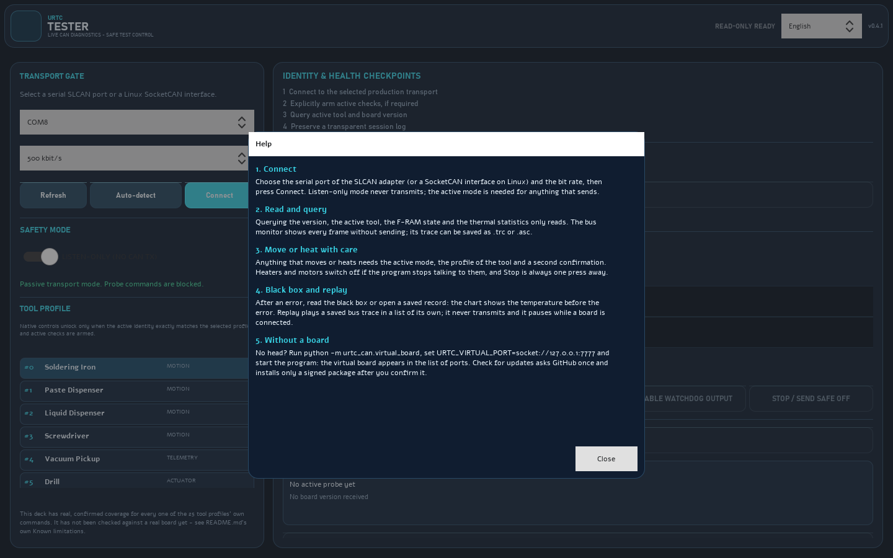
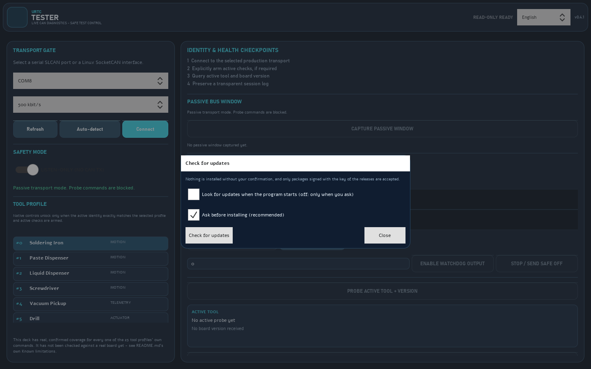

# The window of the tester, step by step

These pictures are the real window, loaded without a screen and drawn to a file by `tools/capture_screens.py` (`python tools/capture_screens.py` writes them again). They show the program as it opens: nothing is connected, nothing is sent, and the language is English. The same texts exist in the eight languages of the program, and the **Help** button of the deck shows the quick guide in the language you chose.

## 1. The deck as it opens

* **Transport gate** (left): choose the serial port of the SLCAN adapter (or a SocketCAN interface on Linux) and the bit rate, then press **Connect**. **Auto-detect** only listens to the bus, sends nothing and finds the bit rate. With no hardware, run `python -m urtc_can.virtual_board`, set `URTC_VIRTUAL_PORT=socket://127.0.0.1:7777` and the virtual board appears in the list of ports.
* **Safety mode**: the program starts listen-only. Everything that sends something needs the active mode, the profile of the tool and a second confirmation; heaters and motors switch off when the program stops talking to them.
* **Tool profile**: the commands of a tool unlock only when the tool that answers is the one selected.
* **Identity and health checkpoints** (right): the four steps of a first connection, the passive bus window, the advanced profile control and the active tool read-out.

## 2. Help

The **Help** button opens five short steps in the language of the window: connect, read and query, move or heat with care, the black box and the replay of a saved trace, and working without a board.

## 3. Check for updates

**Check for updates** asks GitHub once, only when you press it. Both options are conservative: the check at start is off, and an update is installed only after you confirm it and only if the signature of the package matches the key of the releases pinned in the program; the previous version is kept so you can go back.

## What the pictures do not show

They do not show a board answering. Nothing in this guide has been run against a real board; the README lists what has and has not been checked.
